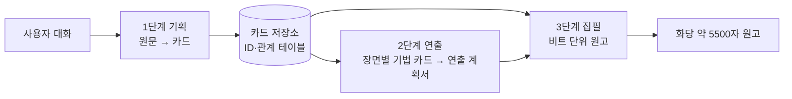
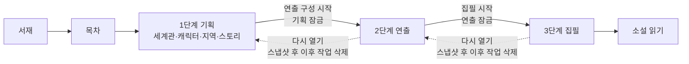
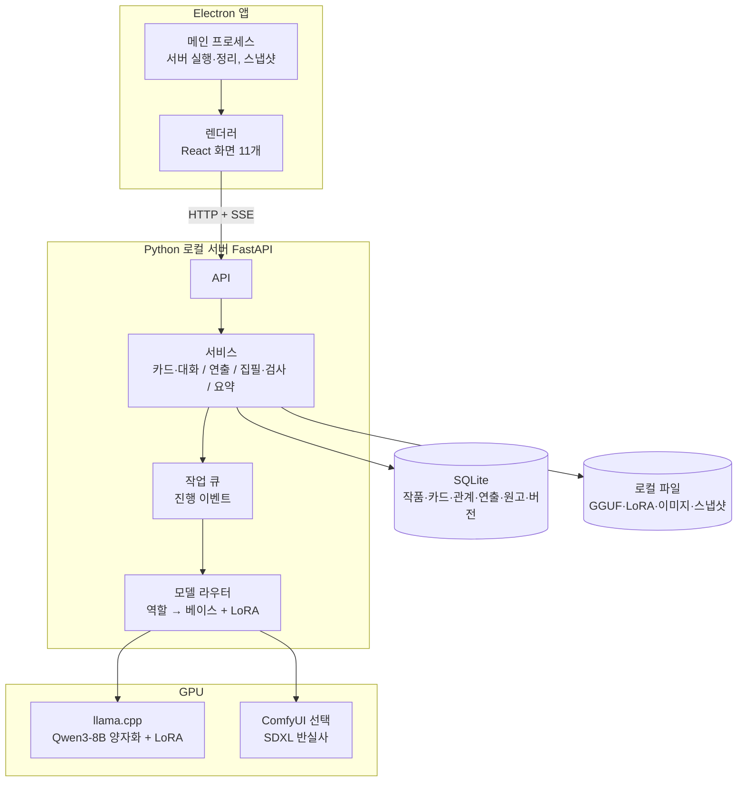
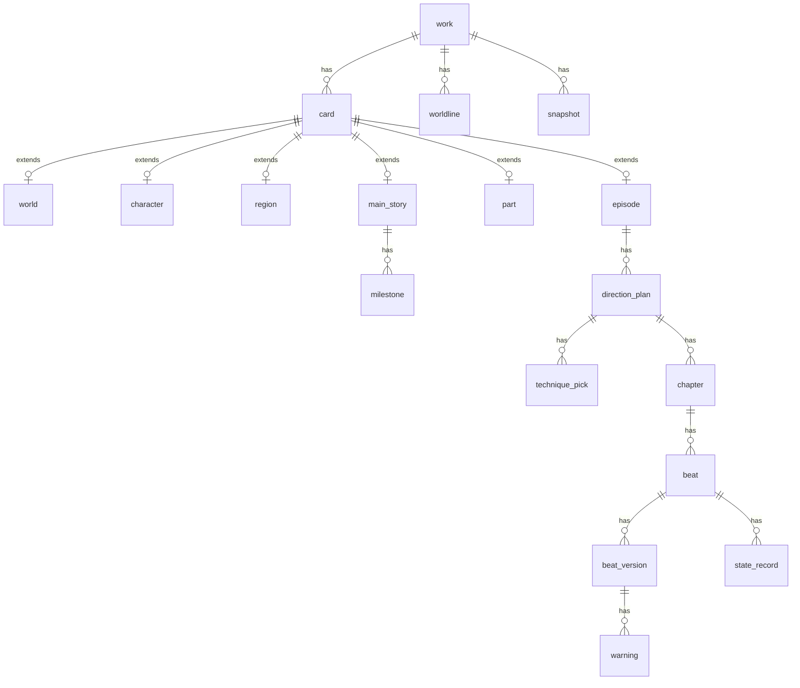
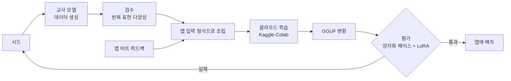

# Aiplot (에이플롯)

**AI Plans, Lays Out, Types.**

로컬 PC에서 동작하는 웹소설 창작 앱. 기획 → 연출 → 집필 3단계를 거쳐 한국 웹소설 형식의 원고를 만든다. 모델과 데이터는 모두 사용자 PC 안에서 돌아간다.

## 목차

1. [프로젝트 이름](#프로젝트-이름)
2. [개요](#개요)
3. 기능 설계: [1단계 기획](#1단계-기획) · [2단계 연출](#2단계-연출) · [3단계 집필](#3단계-집필)
4. [화면 설계](#화면-설계)
5. [시스템 설계](#시스템-설계)
6. [모델 구성](#모델-구성)
7. [개발 순서와 평가 계획](#개발-순서와-평가-계획)
8. [위험 요소와 대응](#위험-요소와-대응)
9. [개발 환경 시작](#개발-환경-시작)
10. [참고 자료](#참고-자료)

---

## 프로젝트 이름

**AI** **P**lans, **L**ays **O**ut, **T**ypes. AI가 계획하고(기획), 펼치고(연출), 쓴다(집필). 베이스 단어 Plot 앞에 Ai를 붙여 "AI 작가"의 느낌과 기획·연출·집필 도구라는 정체성을 함께 담았다.

- 국내 상표: KIPRIS에서 AIPLOT, 에이아이플롯, 에이플롯 모두 검색 결과 없음 (2026년 10월 29일 기준). 핵심 상품분류는 09류(소프트웨어), 필요하면 42류(소프트웨어 서비스)와 41류(출판·콘텐츠).
- 같은 이름의 앱·서비스: 웹 검색에서 찾지 못함.
- 실제 상표 출원 전에는 변리사 상담으로 유사군 코드와 발음 유사성까지 확인한다.

---

## 개요

로컬 PC에서 동작하는 웹소설 집필 앱으로, 기획 → 연출 → 집필 3단계를 거쳐 한국 웹소설 형식의 원고를 자동 생성한다. 모델과 데이터는 모두 사용자 PC에서 돌아가는 것을 전제로 한다.

| 단계 | 하는 일 | 주체 | 결과물 |
|---|---|---|---|
| 1. 기획 | 세계관·캐릭터·지역·스토리 설정을 병렬로 정리 | 사용자 의견 + AI 정리 | 카드 (세계관, 캐릭터, 지역, 메인 스토리, 파트, 에피소드) |
| 2. 연출 | 서술 순서 재배열, 화 분할, 장면별 연출 지시 | 자동 (기법 카드 + 연출 LoRA), 사용자는 장면별 기법 카드 선택 | 연출 계획서 |
| 3. 집필 | 비트 단위로 원고 생성, 상태 추적·개연성 검사 | 자동 (로컬 LLM + 카드 조회) | 화당 약 5500자 원고 |

각 단계의 결과물이 다음 단계의 입력이 되므로, 1단계 카드의 구조(ID 참조, 떡밥, 긴장도, 서사 구조)가 전체 품질을 좌우한다.



1단계가 쌓은 카드 저장소를 2·3단계가 꺼내 쓰고, 2단계의 연출 계획서가 3단계 집필의 입력이 된다.

---

## 1단계: 기획

사용자가 세계관·캐릭터·지역·스토리 설정을 순서 없이 병렬로 제시하면, LLM이 이를 바탕으로 카드를 자동 생성한다. 사용자는 카드를 직접 쓰지 않고 LLM과 대화하며, LLM이 대화 내용을 원문으로 정리한다. 사용자는 LLM이 만든 카드를 확인한 뒤 직접 저장해야 저장된다. 카드끼리는 ID로 서로를 참조한다.

### 공통 원칙

- **관계로 꺼내오기**: 카드는 ID와 관계 테이블로 서로 연결하고, 맥락이 필요할 때 관련 카드를 관계로 꺼내온다. 의미 검색(임베딩)은 쓰지 않는다.
- **초기값 개념**: 외형, 성격, 지역 상태처럼 이야기 중 변하는 값은 기획 단계 값을 "초기값"으로 저장하고, 3단계에서 시점별로 갱신한다.
- **원문 보존**: 대화로 정리된 원문(`source_notes`)을 카드와 함께 저장해, 카드를 고칠 때 다시 불러오고 AI의 해석이 섞인 부분을 구분한다. 대화 기록 자체는 저장하지 않는다.

### 세계관 카드

마법 체계, 세력, 시대, 고유 용어처럼 작품의 설정을 주제 하나당 카드 한 장으로 만든다. 설정이 늘어나도 집필할 때는 그 에피소드에 필요한 카드만 맥락에 넣어 8k 컨텍스트 안에서 버틴다.

| 항목 | 내용 | 비고 |
|---|---|---|
| name / category | 설정 이름, 분류(규칙·능력 / 세력·조직 / 역사·사건 / 문화·용어 / 기타) | 설정집의 분류 책갈피 |
| summary / details | 한 줄 요약, 자세한 설명 | 요약은 다른 카드를 만들 때 입력으로 들어감 |
| rules | 반드시 지켜지는 규칙과 예외 | 3단계 세계관 규칙 위반 검사의 근거 |
| terms | 고유 용어와 뜻 | 집필 맥락에 넣어 용어를 일관되게 씀 |
| related | 얽힌 캐릭터·지역·세계관 카드 ID | 세력의 구성원, 규칙이 통하는 지역 등 |

### 캐릭터 카드

| 항목 | 내용 | 비고 |
|---|---|---|
| theme | 캐릭터가 보여주는 주제 | 예: 평범한 사람도 영웅을 꿈꿀 수 있다 |
| personality | 성격 특성 + 상황별 행동 예시 | 행동 예시는 개연성 검사의 근거 |
| speech | 말투 설명 + 예시 대사 3~5줄 | 예시 대사가 집필 품질을 좌우 |
| appearance | 외형 초기값 | 변화는 3단계에서 갱신 |
| relations | 다른 캐릭터 ID + 관계 | |
| origin | 출신 지역 ID | 지역 카드 참조 |

### 지역 카드

| 항목 | 내용 | 비고 |
|---|---|---|
| name | 지역명 | |
| parent / adjacent | 상위 지역, 인접 지역과 이동 시간, 방향(선택) | 지역 지도 배치와 이동 관련 개연성 검사에 사용 |
| appearance | 생김새 | |
| environment | 자연환경(기후·지형) / 사회환경(치안·문화·세력) 분리 | |
| sensory | 냄새·소리·분위기 묘사 | 2·3단계 연출·집필 재료 |

### 스토리 카드

메인 스토리 → 파트 → 에피소드의 3단 구조다. 메인 스토리가 작품 전체의 뼈대이고, 파트는 그 뼈대를 큰 덩어리로 나눈 것이며, 에피소드가 각 파트를 채운다. 예: 메인 "용사가 마왕을 무찌른다" → 파트 1 "여정의 시작", 파트 2 "마왕을 향해" → 파트 1의 에피소드 "마을의 위기를 구한다". 카드를 만드는 순서도 메인 → 파트 → 에피소드다.

**메인 스토리 카드**: 큰 주제, 전제, 결말 방향, 그리고 반드시 거쳐야 할 지점(milestones). AI가 파트와 에피소드들이 모든 지점을 채웠는지 점검한다.

**파트 카드**: 메인 스토리를 큰 덩어리로 나눈 단위. 메인의 지점은 모두 어느 한 파트에 배정된다.

| 항목 | 내용 |
|---|---|
| id / parent | 파트 ID, 메인 스토리 카드 ID |
| order | 몇 번째 파트인지 (순서) |
| title / theme | 파트 제목과 파트의 주제 |
| fulfills | 이 파트가 맡는 메인 지점 ID |
| start / end | 파트가 시작할 때와 끝날 때의 상황 (다음 파트로 넘어가는 연결점) |
| structure (선택) | 파트 전체의 서사 구조(4·5단계)와 긴장도 |

**에피소드 카드**

| 항목 | 내용 |
|---|---|
| part / part_stage | 소속 파트 카드 ID, 파트 기준 서사 단계 |
| fulfills | 채우는 메인 지점 ID (복수 가능) |
| theme / relation_to_main | 작은 주제와 메인 주제와의 관계 |
| characters / locations | 캐릭터·지역 카드 ID |
| world | 이 에피소드에서 쓰이거나 드러나는 세계관 카드 ID (2·3단계 맥락) |
| order | 앞뒤 에피소드, 원인이 된 에피소드 |
| foreshadowing | 까는 떡밥, 회수하는 떡밥 |
| worldline | 소속 세계선 (회귀물 대응) |
| structure | 서사 구조 유형 + 단계별 내용·긴장도(1~5) |

### 서사 구조 선택 가이드

에피소드마다 4단계(기승전결)와 5단계(발단·전개·위기·절정·결말) 중 하나를 고른다. 선택 화면에 다음 가이드를 보여준다.

- **5단계**: 갈등이 점점 커지다 한 번에 터지는 이야기. 예: 중간보스전, 마을을 덮친 위기, 추격과 탈출
- **4단계**: 흐름이 한순간에 뒤바뀌는 이야기. 예: 일상, 개그, 로맨스, 반전이 핵심인 이야기
- **판단 질문**: 가장 중요한 순간이 "싸움이 터지는 순간"이면 5단계, "상황이 뒤집히는 순간"이면 4단계

에피소드 카드의 주제·줄거리를 보고 AI가 추천과 이유를 띄우되, 선택은 사용자가 한다. 형식 전환은 5→4는 자동(전개+위기 → 승), 4→5는 AI가 "승"을 나누는 안을 제안하고 사용자가 확인한다. 내부적으로 두 구조의 대응 관계(기=발단, 승=전개+위기, 전=절정, 결=결말)를 두어 긴장도 곡선을 하나로 잇는다.

---

## 2단계: 연출

1단계 스토리 카드의 **스토리 순서**(사건이 실제로 일어난 순서)를 **서술 순서**(독자에게 보여주는 순서)로 재배열하고, 장면마다 보여주는 방식을 정한다. AI가 에피소드를 장면으로 나누고, 연출이 필요한 장면마다 기법 카드 1~3장을 추천한다. 사용자는 카드를 골라 연출 방식을 정하고, 추천이 1장이면 묻지 않고 자동으로 선택된다.

### 결정하는 것

- 서술 순서: 회상, 인 메디아스 레스, 떡밥 공개 시점 배치
- 화 분할: 에피소드 1개를 1~5화로 나누고, 위기 직후처럼 다음 화를 누르게 만드는 지점에서 끊기
- 장면별 연출 방식: 장면마다 추천 기법 카드 중 하나를 고르고, 그 안의 비트마다 시점(POV)과 장면화/요약 여부를 정한다

### 연출 계획서 형식

```json
{
  "episode": "episode_007",
  "chapters": [
    {
      "chapter": 1, "target_chars": 5500, "cut_after": "episode_007.위기",
      "scenes": [
        {
          "scene": 1, "source": "episode_007.위기",
          "picks": [
            { "technique": "tech_04", "name": "인 메디아스 레스", "rank": 1,
              "reason": "첫 화 이탈 방지를 위해 긴장도 높은 장면으로 시작" },
            { "technique": "tech_09", "name": "시간 순 전개", "rank": 2,
              "reason": "독자가 상황을 차분히 따라가게 함" }
          ],
          "chosen": "tech_04",
          "beats": [
            { "order": 1, "pov": "테오 1인칭", "mode": "장면화", "tension": 4, "target_chars": 800 }
          ]
        },
        {
          "scene": 2, "source": "episode_007.발단",
          "picks": [ { "technique": "tech_12", "name": "회상", "rank": 1, "reason": "위기 직후 원인을 보여줌" } ],
          "chosen": "tech_12",
          "reveal": ["종탑 아래의 봉인"],
          "beats": [ { "order": 2, "pov": "테오 1인칭", "mode": "요약", "tension": 2, "target_chars": 600 } ]
        }
      ]
    }
  ]
}
```

장면은 같은 기법으로 연출하는 비트 묶음이다. `picks`가 1개인 장면(장면 2)은 묻지 않고 자동으로 선택되고, 2~3개인 장면(장면 1)은 사용자가 고른다. 이 형식은 카드 JSON 스키마와 같은 방식으로 `schemas/`에서 관리한다.

### 연출 모델: 기법 카드 + 파인튜닝

| 구성 요소 | 역할 |
|---|---|
| 기법 카드 선택 | 연출 관련 논문·서적을 정리한 기법 카드 목록(제목·한 줄 요약)에서 장면마다 맞는 카드를 고르고, 그 카드의 정의·효과·주의점을 맥락에 넣음 |
| 파인튜닝 모델 | 에피소드를 장면으로 나누고, 장면마다 추천 기법 카드 1~3장을 순위·이유와 함께 고른 뒤 계획서 형식으로 출력 |

로컬에서 돌리는 8B급 모델(Qwen3-8B)은 이론을 맥락으로 받아도 긴 맥락에서 적용하는 판단이 약하다. 그래서 큰 교사 모델의 연출 판단을 작은 모델로 옮기는 파인튜닝이 판단 품질을 맡고, 기법 카드는 근거 제시와 기법 확장을 맡는다. 연출 LoRA의 학습 데이터 설계는 [학습 데이터 계획](#학습-데이터-계획)에 정리했다.

---

## 3단계: 집필

로컬 LLM이 연출 계획서와 카드를 받아 한국 웹소설 형식의 원고를 자동으로 쓴다. 한 화는 약 5500자(공백 포함), 에피소드 하나는 1~5화로 구성한다.

### 호출 단위: 비트

처음 구상은 문단 단위 호출이었다. 그러나 웹소설 문단은 짧아 한 화가 40~80문단이 되므로, 호출이 많아 느리고 흐름이 끊기며 문장 시작이 반복되기 쉽다. 그래서 **비트(장면 속 작은 사건 하나) 단위, 500~1000자**로 호출하고, 한 화(약 5500자)당 6~10회 호출을 목표로 한다.

### 호출마다 넣는 맥락

- 이번 비트의 연출 지시 (계획서에서)
- 직전 원고 약 1000자 (문체·흐름 유지)
- 지금까지의 요약: 가까운 내용은 길게, 먼 내용은 짧게 넣는다 (아래 요약 단계)
- 등장 캐릭터 카드, 특히 말투 예시 대사
- 이번 에피소드의 세계관 카드와 등장 캐릭터·지역에 얽힌 세계관 카드 (요약, 규칙, 용어)
- 현재 상태 정보: 위치, 부상, 소지품, 아는 비밀, 관계·외형 변화 (상태 기록 항목)

**요약 단계**

요약은 집필 맥락에 넣기 위해 "요약" 역할이 만든다. 바로 앞 내용일수록 감정선과 대화 흐름, 방금 깐 떡밥까지 필요하고, 먼 내용은 큰 사건만 알면 된다. 부상·위치 같은 사실은 상태 기록이 따로 들고 있다.

| 요약 | 길이 | 만드는 때 | 맥락에 넣는 범위 |
|---|---|---|---|
| 이번 화 진행 요약 | 약 300~500자 | 비트가 끝날 때마다 갱신 | 지금 쓰는 화 (직전 원고 1000자보다 앞쪽 비트) |
| 화 상세 요약 | 약 1000자 | 화가 끝날 때 | 바로 앞 화 1개 |
| 화 짧은 요약 | 약 200자 | 화가 끝날 때 (상세 요약을 줄임) | 같은 에피소드의 그 이전 화들 |
| 에피소드 요약 | 약 300자 | 에피소드가 끝날 때 | 지난 에피소드 중 최근 몇 개 |

요약 전체는 약 2000자를 넘지 않게 자르고, 넘으면 오래된 에피소드 요약부터 뺀다. 소설 읽기 화면에서는 화 상세 요약을 "지난 화 요약"으로 보여줄 수 있다.

**집필 호출 1회의 맥락 예산 (대략, 실측 후 조정)**

| 항목 | 분량 |
|---|---|
| 지시문과 문체 명세서 요약 | 약 1000토큰 |
| 비트 지시 | 약 300토큰 |
| 요약 전체 (상한 약 2000자) | 약 1500토큰 |
| 직전 원고 약 1000자 | 약 800토큰 |
| 등장 캐릭터 카드와 말투 예시 | 약 1000토큰 |
| 세계관 카드 (요약·규칙·용어) | 약 400토큰 |
| 상태 기록 | 약 200토큰 |
| 출력 (비트 500~1000자) | 약 800토큰 |
| 합계 | 약 6000토큰 / 8k |

한국어는 대략 1~1.5자당 1토큰으로 잡았다. 개발 1단계에서 실제 토크나이저로 재고 조정한다.

### 상태 추적과 개연성 검사

비트를 하나 쓸 때마다 상태 정보를 갱신하고, 다음 비트 전에 카드·상태와 모순이 없는지 검사한다. 캐릭터가 하지 않을 행동, 맞지 않는 외형, 불가능한 이동, 세계관 규칙을 어기는 장면을 잡아낸다.

### 분량 관리

- LLM에게 글자 수를 맡기지 않고, 비트별 목표 분량을 정한 뒤 코드로 실제 글자 수를 센다.
- 남은 분량에 따라 다음 비트의 목표 분량을 조정한다.
- 글자 수 기준은 연재 플랫폼 관행에 따라 공백 포함으로 센다.

### 한국 웹소설 형식

- 짧은 문단, 잦은 줄바꿈, 대사는 별도 줄
- 화 끝은 계획서의 `cut_after` 지점에서 다음 화를 유도하며 끊기

### 집필 모델

집필은 Qwen3-8B 무검열 베이스에 문체 명세서를 넣은 프롬프트로 시작하고, 이후 직접 학습한 웹소설 LoRA로 바꾼다. 베이스 선정 이유와 학습 데이터 원칙은 [모델 구성](#모델-구성)에 정리했다.

---

## 화면 설계

화면 설계의 중심 원칙은 "AI가 제안하고 사용자가 결정한다"이다. AI의 자동화와 사용자의 직접 조작을 함께 엮는 혼합 주도형(mixed-initiative) 설계를 따르고, 로컬 모델의 긴 생성 시간은 진행 표시와 백그라운드 실행으로 흡수한다.

### 적용할 UX 이론

| 이론 | 핵심 내용 | 이 앱에서의 적용 |
|---|---|---|
| [혼합 주도형 UI (Horvitz, CHI 1999)](https://www.microsoft.com/en-us/research/publication/principles-mixed-initiative-user-interfaces/) | 자동화와 직접 조작을 결합, AI의 추측을 보여주고 사용자가 고쳐 저장 | 카드 정리, 연출 계획, 원고 모두 "AI 초안 → 사용자 수정 → 확정" 흐름 |
| [Human-AI 상호작용 가이드라인 18개 (Microsoft, CHI 2019)](https://www.microsoft.com/en-us/research/blog/guidelines-for-human-ai-interaction-design/) | 할 수 있는 것과 정확도 알리기, 쉬운 수정, 불확실하면 선택지 제시, 이유 설명, 세분화된 피드백, 전역 설정 | 장면별 기법 카드 1~3장 추천, 근거 카드 표시, 비트별 피드백, 자동화 수준 설정 |
| [Nielsen 10 휴리스틱](https://www.nngroup.com/articles/ten-usability-heuristics/) | 시스템 상태 가시성, 사용자 통제(실행 취소), 오류 예방, 회상보다 인식, 효율성, 미니멀 디자인 | 상단 단계 표시, 버전 기록·되돌리기, 카드 참조 자동완성, 단축키 |
| [점진적 공개 (NN/g)](https://www.nngroup.com/videos/progressive-disclosure/) | 주요 기능만 먼저 보이고, 부가 옵션은 보조 화면으로 미룸 | 카드 필수 항목만 먼저, 고급 항목·근거·원문은 펼쳐 보기 |
| [응답 시간 한계 0.1/1/10초 (Nielsen)](https://www.uxtigers.com/post/time-scales-ux) | 1초 안이면 사고 흐름 유지, 10초를 넘으면 주의가 흩어짐 | 카드 편집은 즉시 반응, 생성은 스트리밍 출력, 10초 이상 작업은 진행률 표시 |
| [긴 대기와 중단 설계 (NN/g)](https://www.nngroup.com/articles/designing-for-waits-and-interruptions/) | 남은 단계 표시, 완료 요약, 사용자 메모, 최근 작업 목록, 백그라운드 실행 | 화 생성 진행표, 완료 요약 모달, 목차의 "이어서 작업", 작업 메모 |
| [Hick의 법칙·선택 과부하 (Laws of UX)](https://lawsofux.com/) | 선택지가 많을수록 결정이 느려짐 | 추천 카드는 최대 3장, 가장 추천하는 카드를 강조, 1장이면 묻지 않음 |
| [Zeigarnik 효과·목표 기울기 효과 (Laws of UX)](https://lawsofux.com/) | 미완료 작업이 더 잘 기억되고, 목표에 가까울수록 동기가 커짐 | 메인 지점 충족률, 미회수 떡밥 수, 화별 진행률 표시 |
| [공통 영역·근접성 법칙 (Laws of UX)](https://lawsofux.com/) | 같은 경계 안이나 가까이 있는 요소를 한 묶음으로 인식 | 카드 항목을 성격·말투·외형 묶음으로 구분, 카드 종류별 색 구분 |
| [Jakob의 법칙 (Laws of UX)](https://lawsofux.com/) | 사용자는 익숙한 다른 앱처럼 동작하길 기대 | 카드는 노트 앱, 원고는 워드프로세서, 구조는 타임라인 앱의 관례를 따름 |

### 화면 구조

앱은 11개 화면으로 이루어진다. 모든 작업은 서재에서 책을 골라 목차로 들어간 뒤, 목차에서 항목 하나를 골라 들어가는 순서를 따른다.

| ID | 화면 | 들어가는 곳 | 역할 |
|---|---|---|---|
| S0 | 서재 | 앱 실행 | 작품 목록, 새 작품 시작 |
| S0-1 | 첫 실행 안내 | 최초 실행 1회 | 앱의 기능과 한계 안내, 모델 내려받기 |
| S1 | 목차 | 서재에서 책 선택 | 작품 정보, 3단계 7개 항목, 잠금 상태, 이어서 작업 |
| S1-0 | 설정집 | 목차 | 대화로 원문 정리 → 세계관 카드 생성, 백과사전처럼 분류별 항목 읽기 |
| S1-1 | 캐릭터 도감 | 목차 | 대화로 원문 정리 → 캐릭터 카드 생성 |
| S1-2 | 지역 | 목차 | 대화로 원문 정리 → 지역 카드 생성, 지역 지도 |
| S1-3 | 스토리 | 목차 | 대화로 원문 정리 → 메인 스토리 → 파트 → 에피소드 순서로 설정, 에피소드 타임라인 |
| S2 | 연출 구성하기 | 목차 | 장면별 기법 카드 선택, 서술 순서, 화 분할 |
| S3-1 | 집필하기 | 목차 | 비트 단위 생성, 개연성 경고, 버전 기록 |
| S3-2 | 소설 읽기 | 목차 | 화 목록, 읽음 표시, 정렬 |
| S3-3 | 리더 | 소설 읽기에서 화 선택 | 한 화 본문 읽기 |
| G | 설정 | 어느 화면에서나 | 자동화 수준, 모델, 테마, 단축키 |

### 작업 흐름

사용자는 서재 → 목차 → 단계별 화면 순서로 움직이고, 한 단계 안에서는 작업을 반복한다. 다음 단계를 시작하는 순간 앞 단계는 잠기고, 거꾸로 돌아가려면 백업 후 이후 작업을 지워야 한다.



기획에서는 카드를 하나 저장할 때마다 다음 카드로 돌아가고, 집필에서는 경고를 처리하면 다음 비트로 넘어간다. 확인 단위(비트·화·에피소드)는 설정의 자동화 수준을 따른다.

### 공통 레이아웃

- **상단 바**: 왼쪽에 작품 제목(누르면 목차), 가운데에 기획·연출·집필 단계 표시, 오른쪽에 설정. 서재를 뺀 모든 화면에 같은 자리에 둔다. (상태 가시성, 목표 기울기)
- **빠른 이동**: 어느 화면에서나 Ctrl+K로 카드나 화를 검색해 바로 연다. (회상보다 인식)
- **작업 영역**: 화면마다 내용에 맞는 모양을 쓴다. 세계관은 백과사전 모양의 설정집, 캐릭터는 도감 그리드, 지역은 지도, 스토리는 타임라인, 연출과 집필은 3단(목록 / 작업 / 근거·경고)이다.
- **AI는 화면 안에서**: AI 제안, 근거, 개연성 경고는 해당 화면의 오른쪽 패널이나 카드 생성 서랍에서 보여주고, 패널은 접을 수 있다. (점진적 공개, 이유 설명)
- **홈 화면**: 앱을 열면 작품을 책으로 보여주는 서재가 나온다.

### 홈 화면: 서재

앱을 열면 서재가 첫 화면으로 나온다. 기존 작품은 책장에 꽂힌 책으로, 맨 끝의 반투명한 책에 + 기호를 넣어 새 작품을 시작한다.

- **책 한 권 = 작품 하나**: 표지에 제목과 현재 단계(기획·연출·집필), 집필 중이면 화 수를 표시한다.
- **최근 작업 순 정렬**: 가장 최근에 작업한 책이 맨 앞에 오고 강조 표시된다. 책을 누르면 목차가 열리고, 마지막으로 작업한 항목이 표시된다. (최근 작업 목록)
- **새 작품 책**: 반투명한 책은 항상 맨 끝 같은 자리에 있어 찾기 쉽다. 누르면 "새로 만들기"와 "백업 파일에서 가져오기" 중 고른다. 새로 만들기는 제목만 입력하고 바로 새 책의 목차로 들어간다. (점진적 공개)
- **요약 미리보기**: 책에 마우스를 올리면 메인 주제, 마지막 수정일, 화 수를 보여준다. (점진적 공개)
- **책 관리**: 책을 우클릭하면 "제목 바꾸기 / 백업 생성 / 삭제" 메뉴가 뜬다. 삭제할 때는 지워질 화 수와 카드 수를 보여주고, 작품 제목을 입력해야 확정된다. (오류 예방)
- **생성 중 표시**: 백그라운드에서 원고를 생성 중인 책에는 진행률 띠를 표시한다. (상태 가시성)
- **선택 사항**: 쓴 화 수에 따라 책이 두꺼워지게 해 진행도를 표현한다. (목표 기울기)
- **책이 많아지면**: 책장을 여러 칸으로 늘리고 제목 검색을 제공한다.

서재와 책이라는 비유는 Nielsen 휴리스틱 2번 "시스템과 현실 세계의 일치"에 해당한다. 작가에게 익숙한 개념으로 작품을 보여주어 처음 보는 사용자도 바로 이해할 수 있다.

### 목차: 항목 선택과 단계 잠금

책을 누르면 책을 펼친 모양의 목차가 열린다. 왼쪽 면에는 작품 정보, 오른쪽 면에는 3단계 7개 항목의 목차가 있고, 항목을 골라 그 화면으로 들어간다. 다음 단계를 시작하면 이전 단계는 잠기고, 이전 단계를 다시 열면 이후 단계 작업이 사라진다.

- **책 펼침 모양**: 서재의 책을 펼친 모양으로 열어 서재와 같은 비유를 이어 간다. (시스템과 현실 세계의 일치)
- **왼쪽 면, 작품 정보**: 제목, 메인 주제, 현재 단계, 카드 수, 마지막 수정일을 보여준다. 아래의 "이어서 작업" 버튼으로 마지막에 작업한 항목에 바로 들어간다. (최근 작업 목록) 그 위에 "원고 내보내기"와 "백업 생성" 버튼을 나란히 둔다.
- **오른쪽 면, 목차**: 단계별로 항목(기획: 세계관·캐릭터·지역·스토리 / 연출 / 집필: 집필·소설 읽기)을 묶고, 항목 오른쪽에 점선을 이어 현재 상태(카드 수, 진행한 화 수, 시작 전)를 쪽 번호처럼 보여준다. (상태 가시성)
- **마지막 작업 표시**: 마지막으로 작업한 항목에 강조 띠를 둔다.
- **잠금 표시**: 아직 열리지 않은 단계는 흐리게, 지난 단계는 자물쇠와 함께 읽기 전용으로 표시한다. 흐린 항목을 누르면 열리는 조건을 알려준다.
- **목차로 돌아가기**: 각 화면 위쪽의 작품 제목을 누르면 목차로 돌아온다. 목차의 "← 서재"로 서재에 간다.

#### 단계 잠금

- 2단계나 3단계를 시작하면 목차의 이전 단계 항목이 잠기고, 읽기 전용으로만 열린다.
- 잠긴 이전 단계를 다시 열면, 그 이후 단계에서 작업한 내용이 모두 삭제된다.
- 다음 단계로 넘어갈 때와 이전 단계로 돌아갈 때 모두 경고 문구를 띄운다. (오류 예방)

**경고 문구 예시**

- 다음 단계로: "연출 구성을 시작하면 세계관·캐릭터·지역·에피소드 카드를 더 이상 수정할 수 없어요. 계속할까요?"
- 이전 단계로: "기획 단계를 다시 열면 연출 계획서와 집필한 원고 12화가 삭제돼요. 이 작업은 되돌릴 수 없어요."
- 되돌리기 경고에는 삭제될 항목과 개수를 구체적으로 보여주고, 삭제 버튼은 기본 선택이 아니도록 하고 다른 색으로 구분한다.

**보완 규칙 (채택)**

- 잠긴 단계도 읽기 전용으로 열람: 집필 중에 캐릭터 말투나 지역 설정을 확인할 수 있게 한다. (회상보다 인식)
- 되돌리기 전 자동 백업: 삭제되는 작업을 스냅샷으로 남겨 실수를 복구할 수 있게 한다. (사용자 통제와 자유)
- 원고가 있을 때의 되돌리기는 작품 제목을 입력해야 확정되도록 확인 강도를 높인다.

#### 원고 내보내기

목차 왼쪽 면의 "원고 내보내기" 버튼으로 연다. 완성된 화를 여러 개 골라 플랫폼 복사, txt, docx, hwp 중 하나로 내보낸다.

- **화 선택**: 완성된 화를 체크박스로 고르고, 맨 위 "전체 선택"으로 한 번에 고르거나 푼다. 생성 중인 화는 고를 수 없다. 아래에 선택한 화 수와 글자 수(공백 포함)를 보여준다.
- **형식**: 플랫폼 복사, txt, docx, hwp 중 하나를 고른다. 마지막으로 고른 형식을 기억한다.
- **플랫폼 복사**: 연재 사이트 입력창에 바로 붙여 넣을 수 있게 문단 사이 빈 줄과 대사 줄바꿈을 정리해 클립보드에 넣는다. 입력창은 보통 한 화씩 올리므로, 여러 화를 골랐으면 "다음 화 복사"로 순서대로 복사한다.
- **파일 저장**: txt·docx·hwp는 "한 파일로 합치기"(화 제목으로 구분)와 "화마다 따로 저장" 중 고르고, 저장 위치는 운영체제 저장 창에서 정한다.
- **hwp 구현**: 구형 .hwp(바이너리) 파일을 쓰는 라이브러리는 거의 없어, 한글에서 그대로 열리는 개방형 형식 .hwpx로 저장한다. 한글이 설치된 PC에서는 한글 자동화 기능으로 .hwp 저장도 가능하다.
- **언제든 사용**: 내보내기는 원고를 바꾸지 않으므로 단계 잠금과 관계없이 쓸 수 있다.

#### 작품 백업과 가져오기

작품 하나를 백업 파일 하나로 저장하고, 다른 PC나 나중에 그 파일로 되살린다. 자동 백업은 두지 않고, 사용자가 원할 때 목차 왼쪽 면의 "백업 생성" 버튼으로 만든다.

| 항목 | 내용 |
|---|---|
| 파일 | 작품 하나 = 파일 하나 (예: `용사의 여정_2026-10-29.aiplot`). 내부는 압축 파일로, 작품 데이터와 이미지, 앱·데이터 버전 정보를 담는다 |
| 담는 것 | 카드와 원문, 연출 계획서, 원고와 버전 기록, 상태 기록, 개연성 경고, 캐릭터 이미지 |
| 빼는 것 | 모델·LoRA 파일 |
| 만들기 | 목차 왼쪽 면 "백업 생성" → 운영체제 저장 창에서 위치 선택 → 완료 후 파일 위치와 크기 표시 |
| 가져오기 | 서재의 새 작품 책을 누르면 "새로 만들기"와 "백업 파일에서 가져오기" 중 고른다 |

- **덮어쓰지 않음**: 서재에 같은 작품이 있어도 덮어쓰지 않고 "용사의 여정 (가져옴)"처럼 새 책으로 추가한다. (오류 예방)
- **버전 확인**: 백업 파일의 데이터 버전이 앱보다 새로우면 앱 업데이트를 안내하고, 오래되었으면 가져오면서 변환한다.
- **단계 되돌리기 스냅샷과 구분**: 단계를 되돌리기 전에 만드는 자동 스냅샷은 실수 복구용으로 그대로 두고, 앱 안에서만 쓴다.

### 1단계 기획 화면 (S1-0 ~ S1-3)

세계관 카드는 백과사전처럼 펼친 설정집, 캐릭터 카드는 카드 게임의 도감, 에피소드 카드는 지역과 시간 순서로 배치한 타임라인 그래프로 보여준다. 지역 카드는 지역끼리의 상대 위치를 그린 지도로 보여준다. 네 화면 모두 새 카드는 아래의 카드 생성 서랍에서 만든다.

#### 카드 생성 서랍 (공통)

모든 카드는 화면 오른쪽에서 밀려나오는 2단 서랍에서 만들고 고친다. 설정집의 "+ 새 설정", 도감의 + 카드, 설정집 항목과 카드 뒷면의 "원문 수정", 타임라인의 "+ 새 에피소드", 지역 지도의 "+ 새 지역" 버튼, 메인 스토리·파트 설정 단계에서 열린다. 사용자가 LLM과 대화하면 LLM이 그 내용을 원문으로 정리하고, 카드는 원문에서 생성한다. 사용자가 저장하면 원문과 카드가 함께 저장된다. 세계관·캐릭터·지역·메인 스토리·파트·에피소드 카드 모두 같은 방식이다.

```text
┌──────────────────────────────────────────────────────────┐
│ 캐릭터 · 수정 · 레오                                   X │
├────────────────────────────┬─────────────────────────────┤
│ 대화                       │ 카드 미리보기               │
│  LLM: 화가 나면 말투가     │  주제 ...                   │
│       바뀌나요?            │  말투 ~~이전 값~~ → 새 값   │
│  나: 반말로 거칠어져       │  외형 ... [AI 추정]         │
├────────────────────────────┤  관계 ...                   │
│ 원문 (직접 수정 가능)      │                             │
│  레오는 남부 출신 ...      │        [카드 생성] [저장]   │
└────────────────────────────┴─────────────────────────────┘
```

- **형태**: 화면 너비의 약 70%를 덮는 서랍. 뒤쪽의 도감이나 타임라인은 흐리게 남아, 어떤 카드를 다루는지 맥락이 유지된다. 왼쪽 열은 위에 대화, 아래에 원문, 오른쪽 열은 카드 미리보기이며 모든 카드 종류가 같은 배치를 쓴다. (일관성과 표준)
- **머리 영역**: 카드 종류, 새 카드/수정 구분, 카드 이름을 보여준다. 에피소드는 소속 파트와 지역을, 파트는 맡은 메인 지점을 함께 표시한다. 오른쪽 위 X나 Esc로 닫는다. (상태 가시성)
- **대화로 쓰기**: 사용자가 대화창에 설정을 말하면 LLM이 받아 적고, 빠진 내용은 질문한다. 예: "화가 나면 말투가 바뀌나요?" 새 카드는 LLM이 앞 단계 카드를 바탕으로 첫 질문이나 초안을 먼저 꺼낼 수 있고, 파트 설정은 LLM이 파트 설정 초안을 먼저 제안하는 것이 기본이다. (혼합 주도형)
- **원문으로 정리**: 답할 때마다 LLM이 원문에 반영할 것만 낸다. 새 사실은 새 문장으로 덧붙이고, 사용자가 뒤집은 설정만 그 문장을 고친다("북부 출신" → "남부 출신"). 서버가 이것을 적용하므로 언급되지 않은 문장은 글자 하나 바뀌지 않는다. 방금 바뀐 문장은 잠깐 강조된다. 사용자는 원문을 직접 고칠 수도 있다. 카드의 원본은 대화가 아니라 원문이다.
- **대화 기록**: 대화는 원문을 만드는 도구라 저장하지 않는다. 저장되는 것은 원문과 카드뿐이다. 모델에는 최근 몇 턴, 현재 원문, `@`로 부른 카드만 넣어 8k 맥락 안에서 동작한다.
- **생성과 저장**: 원문 정리 → "카드 생성" → 초안 카드 표시 → 사용자가 "저장"을 누르면 원문과 카드가 함께 저장된다. 저장 전 카드는 초안으로만 보이고 저장소에 들어가지 않는다. 저장하지 않고 서랍을 닫으려 하면 저장할지 묻는다.
- **수정 모드**: 카드 뒷면의 "원문 수정"으로 열면 기존 원문을 불러오고 대화는 새로 시작한다. "말투를 더 거칠게 바꿔줘"처럼 말하면 원문이 고쳐진다. 다시 생성하면 바뀐 항목만 표시하고, 이전 값은 취소선으로 함께 보여준다. 바뀐 항목을 다른 카드가 참조하면(이름, 관계, 등장인물) 저장 전에 그 카드 목록을 보여준다. (오류 예방)
- **항목 고정**: 카드를 직접 고치지 않고 원문을 고친 뒤 다시 생성한다. 마음에 드는 항목은 "고정"해 다시 생성해도 바뀌지 않게 한다. (쉬운 수정)
- **참고 자료**: 카드는 원문을 중심으로 만들고, `@`로 부른 카드와 앞 단계 카드(에피소드는 메인 스토리, 소속 파트, 지역 카드)를 함께 참고한다.
- **근거 하이라이트**: 카드 항목을 누르면 그 항목을 만든 원문 문장이 강조된다. 원문과 참고 카드 어디에도 근거가 없는 항목은 "AI 추정"으로 표시해 사용자가 확인하게 한다. (이유 설명)
- **빈 항목 질문**: 필수 항목이 비면 카드에 "아직 정해지지 않음"으로 표시하고, 대화창에서 채울 질문을 이어서 한다.
- **이름 일관성 검사**: 대화나 원문의 고유명사가 기존 카드 이름과 비슷하면(예: 레오/래오) 대화창에서 같은 인물인지 묻는다. 오타가 새 인물로 잘못 생성되는 것을 막는다. (오류 예방)
- **카드 참조**: 대화와 원문에서 다른 카드는 `@이름`으로 부르고 자동완성으로 고른다. (회상보다 인식)
- **종류별 칸**: 미리보기는 실제 카드 뒷면과 같은 모양이고, 종류에 따라 전용 칸만 붙는다. 캐릭터는 말투 미리보기(생성된 말투로 쓴 짧은 대화 샘플), 에피소드는 서사 구조 선택, 파트는 메인 지점 배정 현황이다.
- **저장 후**: 서랍이 닫히고, 새로 만들거나 고친 카드가 설정집·도감·타임라인에서 잠깐(0.3초) 강조돼 어디에 들어갔는지 보여준다. (상태 가시성)
- **잠금 중**: 2·3단계가 진행 중이면 추가 버튼과 "원문 수정"이 비활성화되고 서랍이 열리지 않는다.

#### 설정집 (S1-0)

세계관 카드는 규칙, 용어, 긴 설명처럼 글이 많아서 진짜 설정집 책처럼 펼쳐 읽는다.

- **왼쪽 면, 목차**: 위에 분류 책갈피(규칙·능력, 세력·조직, 역사·사건, 문화·용어, 기타)가 있고, 그 아래에 항목 이름을 점선과 쪽 번호로 늘어놓는다. 아래쪽 "+ 새 설정"을 누르면 카드 생성 서랍이 열리고, 지금 고른 책갈피의 분류를 AI에게 힌트로 넘긴다. 맨 뒤에는 모든 용어를 가나다순으로 모은 용어집이 있고, 용어를 누르면 그 항목으로 간다.
- **오른쪽 면, 항목**: 고른 항목의 이름, 분류, 한 줄 요약, 자세한 설명, 규칙과 예외, 용어를 한 쪽에 보여준다. 아래 "함께 보기"는 얽힌 카드로 가는 링크다. 세계관 카드는 그 항목으로, 캐릭터와 지역은 도감과 지도의 카드로 간다.
- **편집과 삭제**: 쪽 아래쪽에 "원문 수정"과 빨간 "삭제" 버튼이 있다. 삭제와 되돌리기는 도감과 같다. 저장하면 그 항목 쪽이 펼쳐진다. 이미지는 없다.

#### 캐릭터 도감 (S1-1)

캐릭터 카드는 카드 게임의 도감처럼 모아서 보여준다. 서재와 같은 패턴으로, 맨 끝에 + 카드를 두어 새 캐릭터를 만든다.

- **앞면**: 캐릭터 이미지와 아래쪽 이름만 보여 간략하게 훑어볼 수 있다. 이미지가 아직 없으면 이름 첫 글자로 만든 기본 이미지를 쓴다.
- **+ 카드**: 반투명한 카드에 + 기호. 누르면 카드 생성 서랍이 열리고, 저장하면 도감에 새 카드가 추가된다. (서재와의 일관성)
- **뒷면**: 카드를 누르면 뒤집히는 전환(0.3초)과 함께 상세 정보가 나온다. 주제, 성격(행동 예시), 말투(예시 대사와 말투 미리보기), 외형, 관계, 출신 지역. 긴 항목은 펼쳐서 본다. (점진적 공개)
- **수정**: 뒷면 맨 아래 줄에 왼쪽 "원문 수정", 오른쪽 "삭제"를 둔다. 카드 관리 동작을 한 줄에 모으되, 둘을 양 끝에 떨어뜨리고 삭제는 빨간색으로 구분해 잘못 누르는 일을 줄인다. "원문 수정"을 누르면 그 카드로 생성 서랍이 열려, 원문을 고치고 다시 생성한 뒤 저장한다. (오류 예방)
- **이미지 생성**: 뒷면의 상세 정보 아래, 관리 줄 위에 있는 주 버튼. LLM이 외형과 성격 정보를 이미지 프롬프트로 바꾸고, 이미지 모델이 후보 2~4장을 만든다. 사용자가 하나를 골라야 앞면 이미지로 저장된다. 그림체는 웹소설 표지 스타일(반실사 디지털 페인팅)로 하되, 인물 비율은 큰 눈이나 작은 몸 같은 과장 없이 실사에 가깝게 맞춘다. 이미지는 세로 3:4(896×1152)로 만들어 카드 앞면에 맞춘다. 고른 이미지의 프롬프트와 시드를 함께 저장해, 나중에 다시 만들어도 인상이 크게 달라지지 않게 한다.
- **잠금 중**: 2·3단계가 진행 중이면 뒷면은 읽기 전용이고 원문 수정은 막힌다. 이미지는 이야기 데이터에 영향을 주지 않으므로 잠금 중에도 생성할 수 있다.
- **닫기**: 뒷면 오른쪽 위의 X를 누르거나 Esc 키를 누르면 상세 정보가 닫히고 도감으로 돌아간다.
- **삭제**: 뒷면 맨 아래 줄 오른쪽의 삭제 버튼. 누르면 확인 창을 띄우고, 이 캐릭터를 참조하는 카드(다른 캐릭터의 관계, 에피소드의 등장인물)가 있으면 그 목록을 함께 보여준다. 삭제하면 도감과 저장소에서 모두 지우고, 몇 초 동안 "되돌리기"를 띄운다. (오류 예방, 사용자 통제와 자유)
- **잠금 중 삭제**: 2·3단계가 진행 중이면 삭제 버튼을 비활성화한다. 이미 연출과 원고에 쓰인 카드이기 때문이다.

#### 지역 지도 (S1-2)

지역 하나가 노드 하나이고, 인접한 지역끼리 선으로 잇는다. 캐릭터는 도감, 에피소드는 타임라인이듯 지역은 지도로 보여준다. 정확한 지도가 아니라, 카드에 적힌 인접 관계와 이동 시간으로 상대 위치를 그린 그림이다.

- **노드와 영역**: 상위 지역은 하위 지역을 감싸는 점선 영역으로 그려 어디 안에 있는지 보여준다. 영역을 두 번 누르면 그 안으로 확대한다.
- **연결선**: 인접 지역끼리 선으로 잇고 이동 시간(예: 도보 3일)을 적는다. 선 길이는 이동 시간에 대략 비례하도록 자동 배치한다.
- **방향**: 카드에 "왕도의 북쪽"처럼 방향이 있으면 그 방향을 지켜 배치하고, 없으면 연결 관계만으로 배치한다.
- **위치 다듬기**: 노드를 끌어 보기 좋게 옮길 수 있다. 화면 배치만 바뀌고 카드 내용(인접 지역, 이동 시간)은 바뀌지 않으므로 "카드는 원문으로만 고친다"는 원칙과 충돌하지 않는다.
- **상세 보기**: 노드를 누르면 캐릭터 카드처럼 뒤집혀 생김새, 환경, 분위기, 인접 지역이 나온다. 뒷면 맨 아래 줄은 왼쪽 원문 수정, 오른쪽 삭제로 다른 카드와 같다.
- **에피소드 연결**: 노드에 그 지역에서 일어나는 에피소드 수를 표시하고, 마우스를 올리면 해당 에피소드를 목록으로 보여준다. 타임라인의 지역 레인과 같은 지역 카드를 쓴다.
- **새 지역**: 지도 밖의 "+ 새 지역" 버튼으로 생성 서랍을 연다. 저장하면 연결된 지역 옆에 자동으로 놓인다.
- **개연성 검사와 연결**: 지도의 이동 시간은 3단계에서 불가능한 이동을 잡는 근거가 된다.
- **확대와 이동**: 마우스 휠로 확대·축소하고, 빈 곳을 끌어 지도를 옮긴다.

#### 스토리: 에피소드 타임라인 (S1-3)

에피소드 화면은 메인 스토리 → 파트 → 에피소드 순서로 진행하는 3단계 흐름이다. 화면 위의 단계 표시로 지금 어디인지 보여주고, 앞 단계를 마쳐야 다음 단계가 열린다. (점진적 공개, 상태 가시성)

1. **메인 스토리 설정**: 생성 서랍에서 LLM과 대화해 원문을 정리하면 메인 스토리 카드(큰 주제, 전제, 결말 방향, 거쳐야 할 지점)가 만들어진다. 저장해야 다음 단계가 열린다.
2. **파트 설정**: LLM이 메인의 지점을 바탕으로 파트 설정 초안을 제안하고, 사용자가 대화로 고쳐 원문과 함께 저장한다. 메인의 모든 지점이 어느 한 파트에 배정돼야 다음 단계가 열린다.
3. **에피소드 설정**: 아래 타임라인에서 파트를 고르고 그 안에 에피소드를 추가한다. 에피소드도 생성 서랍에서 대화로 원문을 정리해 만든다.

- **축**: 세로축은 지역 카드에서 만든 지역(레인), 가로축은 스토리 순서(실제로 일어난 순서)다. 정확한 시각이 아니라 앞뒤 관계를 나타내며, 같은 열에 있는 노드는 동시에 일어난 사건이다.
- **노드와 연결선**: 노드 하나가 에피소드 카드 하나다. 화살표는 에피소드 카드의 순서와 인과 연결(앞뒤 에피소드, 원인이 된 에피소드)을 그린다.
- **상세 보기**: 노드를 누르면 캐릭터 카드처럼 뒤집혀 상세 설정이 나온다. 주제, 채우는 메인 지점, 서사 구조(4·5단계)와 단계별 내용, 등장인물, 떡밥, 줄거리.
- **새 에피소드**: 그래프 밖의 "+ 새 에피소드" 버튼으로 생성 서랍을 연다. 지금 선택된 파트에 추가되며, 에피소드의 순서는 그 파트의 범위 안에서만 정해진다. 저장하면 카드에 적힌 순서와 지역에 맞춰 노드가 자동으로 배치된다.
- **2단계와의 연결**: 이 그래프의 가로축은 2단계 연출 화면에 있는 두 줄 타임라인의 윗줄(스토리 순서)과 같은 기준이다.
- **닫기와 삭제**: 캐릭터 카드와 같다. 오른쪽 위의 X나 Esc로 그래프로 돌아가고, 맨 아래 줄 오른쪽의 삭제 버튼으로 노드를 지운다(왼쪽은 원문 수정). 노드를 지우면 이어진 연결선도 사라지므로, 확인 창에서 앞뒤 에피소드를 바로 이어 줄지 함께 고른다.
- **파트 구간**: 가로축을 파트 단위 구간으로 나누고 위쪽에 파트 제목을 표시한다. 맨 위에는 메인 스토리를 한 줄로 보여준다.
- **앞 단계 고치기**: 기획 단계 안에서는 메인 스토리와 파트를 언제든 다시 열어 고칠 수 있다. 에피소드가 들어 있는 파트를 삭제하거나 합치면, 그 에피소드를 다른 파트로 옮길지 함께 지울지 확인 창에서 고른다.
- **노드 끌기**: 노드를 끌어 순서나 지역을 바꿀 수 있고, 같은 파트 범위 안에서만 옮겨진다. 놓으면 LLM이 바뀐 내용을 원문에 한 줄로 반영하고, 사용자가 확인해야 카드에 저장된다. 원문이 원본이라는 원칙을 그대로 지킨다.
- **여러 지역에 걸친 에피소드**: 주 무대 레인에 노드를 두고, 함께 나오는 다른 지역은 노드 아래 작은 지역 표시로 보여준다.
- **메인 지점 표시**: 파트 구간 위에 그 파트가 맡은 지점을 표시하고, 노드 색으로 어느 지점을 채우는지 보여줘 완성도 패널과 연결한다.
- **세계선 (회귀물)**: 타임라인 위의 세계선 탭으로 세계선을 고른다. 회귀가 일어난 에피소드에서 새 세계선이 갈라지는 선으로 표시하고, 갈라지기 전 에피소드는 모든 세계선에 함께 보인다. 세계선이 하나뿐이면 탭을 숨긴다.
- **서사 구조 선택**: 에피소드 카드 서랍의 전용 칸. 4단계/5단계 두 카드를 나란히 놓고 판단 질문과 AI 추천 배지를 보여준다. (Hick의 법칙)
- **완성도 패널**: 메인 지점 충족률, 비어 있는 서사 단계, 회수되지 않은 떡밥을 체크리스트로 보여준다. (Zeigarnik 효과, 목표 기울기)
- **다음 단계로**: 완성도 패널 아래 "연출 구성 시작" 버튼. 누르면 잠금 경고를 띄운다.

### 2단계 연출 화면 (S2)

에피소드를 고르면 AI가 장면을 나누고 장면마다 기법 카드를 추천한다. 사용자는 카드를 고르고, 타임라인을 보며 고친 뒤 계획서를 확정한다.

- **화면 구성**: 왼쪽 에피소드 목록, 가운데 서술 순서 타임라인과 긴장도, 오른쪽 기법 카드 선택과 근거 패널.
- **장면별 기법 카드 선택**: AI가 에피소드를 장면으로 나누고, 연출이 필요한 장면마다 기법 카드 1~3장을 추천한다. 사용자가 카드를 고르면 그 장면의 비트가 그 방식으로 짜인다. 추천이 1장이면 묻지 않고 자동으로 선택해 다음 장면으로 넘어간다. 가장 추천하는 카드에는 테두리가 은은하게 빛나는 효과와 "✦ 추천" 표시, 이유 한 줄을 붙인다. (불확실할 때만 선택지 제시, Hick의 법칙)
- **두 줄 타임라인**: 위에는 스토리 순서, 아래에는 서술 순서를 놓고 같은 사건을 선으로 잇는다. 순서가 바뀐 사건(회상, 앞당기기)은 강조색 선으로 표시한다. (연결성 법칙)
- **직접 조작**: 서술 순서 줄의 비트를 드래그해 순서를 바꾸면, AI가 바뀐 부분의 개연성만 다시 검사한다. (혼합 주도형, 쉬운 수정)
- **근거 보기**: 비트를 고르면 오른쪽 패널에 사용한 기법, 근거 기법 카드, 이유가 나온다. (이유 설명, 점진적 공개)
- **비트별 피드백**: "좋음/별로"와 짧은 메모를 남기고, 이를 이후 학습 데이터로 모은다. (세분화된 피드백)
- **긴장도 곡선과 화 분할**: 서술 순서 기준 긴장도 곡선 위에 화 끊김 지점을 점선으로 표시한다. 점선을 드래그해 화 경계를 옮기면 화별 예상 글자 수가 갱신된다.
- **기획 카드 열람**: 잠긴 1단계 카드는 상단 "기획 보기"에서 읽기 전용으로 연다. (보완 규칙)
- **다음 단계로**: 모든 에피소드의 계획서를 확정하면 "집필 시작" 버튼이 활성화되고, 누르면 잠금 경고를 띄운다.

### 3단계 집필 화면 (S3-1)

화를 고르고 생성을 시작하면 원고가 비트 단위로 흘러나오고, 개연성 경고는 오른쪽에 쌓인다.

- **화면 구성**: 왼쪽 화 목록(완료·생성 중·대기), 가운데 원고, 오른쪽 개연성 경고와 버전 기록.
- **생성 진행표**: 화 단위로 "비트 3/8 · 예상 남은 시간"과 진행 막대를 표시한다. 10초가 넘는 대기에는 반드시 진행률을 보여준다. (상태 가시성, 긴 대기 설계)
- **스트리밍 출력**: 원고를 문장 단위로 흘려 보여줘 체감 대기 시간을 줄인다. 로컬 서버가 토큰을 모았다가 문장이 끝나면(마침표, 물음표, 느낌표, 줄바꿈) 한 번에 보내, 이벤트 수와 화면 갱신 횟수를 토큰 단위보다 크게 줄인다. 모델이 글을 만드는 비용은 표시 단위와 상관없이 같다. (응답 시간 한계)
- **검사 전 흐린 글씨**: 생성 중이거나 아직 개연성 검사를 마치지 않은 비트는 흐린 글씨로 보여준다. 검사가 끝나면 진하게 바뀌고, 경고가 있으면 그 자리에 밑줄이 생긴다. 다시 쓰일 수 있는 부분과 확정된 부분을 구분해, 비트가 다시 생성돼도 덜 혼란스럽게 한다. (상태 가시성)
- **백그라운드 실행**: 생성 중에도 이전 화 검토나 소설 읽기가 가능하다. 끝나면 경과 시간, 생성 글자 수, 개연성 경고 수를 담은 완료 요약을 띄운다. (긴 대기 설계)
- **통제 버튼**: 일시정지, 중단, 비트 단위 재생성을 원고 아래에 항상 노출한다. (사용자 통제와 자유)
- **인라인 개연성 경고**: 문제 문장에 밑줄과 여백 표시를 하고, 오른쪽 경고 카드에 내용과 근거를 보여준다. "수정 제안"을 고르면 해당 비트만 다시 생성하고, "무시"를 고르면 사유를 기록한다. (오류를 인식·진단·복구하도록 돕기)
- **직접 수정**: 원고는 에디터에서 직접 고칠 수 있고, 고친 내용은 상태 기록에 다시 반영되고, 그 화의 진행 요약과 상세·짧은 요약도 다시 만든다. 비트를 다시 생성할 때도 같다.
- **버전 기록**: 비트 재생성이나 직접 수정마다 버전을 남기고 비교·되돌리기를 지원한다. (실행 취소)
- **글자 수 카운터**: 공백 포함 기준 현재 분량과 목표 5500자 대비 진행률을 표시한다.
- **확인 단위**: 설정의 자동화 수준에 따라 비트·화·에피소드마다 확인을 요청하고 멈춘다. 기본값은 화마다 확인이다.

### 소설 읽기 화면 (S3-2, S3-3)

- 완성된 화를 목록으로 보여주고, 읽은 화는 진하게 표시해 어디까지 읽었는지 알 수 있다. (상태 가시성)
- 정렬은 최신순과 오래된 순 중 고른다. 새로 쓴 화를 읽을 때는 최신순, 정주행할 때는 오래된 순으로 본다.
- 마지막으로 고른 정렬 방식을 기억해 다음에 열 때 유지한다.
- **읽음 처리**: 리더에서 화의 끝까지 읽으면 읽음으로 바뀐다. 목록에서 직접 읽음/안 읽음을 바꿀 수도 있다. (사용자 통제와 자유)
- **이어 읽기**: 목록 위의 "이어 읽기" 버튼으로 마지막으로 읽던 화의 읽던 위치를 연다. (최근 작업 목록)
- **리더 화면 (S3-3)**: 본문만 보이는 읽기 전용 화면. 이전/다음 화 이동, 글자 크기와 줄 간격 조절, 화 끝에 다음 화 버튼을 둔다. 편집은 집필하기 화면에서만 한다. (미니멀 디자인)

### 화면 상태 설계

모든 화면은 아래 상태를 같은 방식으로 표시한다. 로컬 모델은 생성이 길고 실패할 수 있으므로, 대기와 오류 상태를 정상 흐름의 일부로 설계한다.

| 상태 | 언제 | 화면 처리 |
|---|---|---|
| 빈 서재 | 작품이 하나도 없을 때 | 반투명한 새 작품 책 하나와 "첫 작품을 시작해 보세요" 안내 |
| 빈 카드 목록 | 카드가 아직 없을 때 | 대화창에서 LLM이 첫 질문을 먼저 건네 무엇부터 정할지 알려준다 |
| 짧은 생성 (10초 미만) | 카드 생성, 이름 확인 | 버튼 안에 진행 표시, 다른 입력은 그대로 가능 |
| 긴 생성 (10초 이상) | 연출 계획·원고 생성 | 진행률, 현재 단계, 남은 시간 표시와 백그라운드 전환 버튼 |
| 완료 | 긴 생성이 끝남 | 완료 요약 창(경과 시간, 결과 수, 경고 수). 사용자가 직접 닫아야 사라진다 |
| 잠금 | 이후 단계 진행 중 | 목차에 자물쇠 표시. 누르면 읽기 전용으로 열리고 상단에 "다시 열기" 버튼 |
| 오류: 모델 문제 | 모델 미설치, 메모리 부족 | 원인과 해결 방법을 쉬운 말로 안내하고 "다시 시도" 버튼. 예: "모델을 불러올 메모리가 부족해요. 다른 프로그램을 닫고 다시 시도해 주세요." |
| 오류: 생성 중단 | 앱 종료, 충돌 | 마지막으로 완성된 비트까지 저장하고, 다음 실행 때 "이어서 생성"을 제안 |

### 시각 디자인 원칙

- **단계 색**: 기획·연출·집필에 각각 고유 색을 정해 상단 단계 표시, 책 표지, 목차에 똑같이 쓴다. 색만으로 구분하지 않고 항상 글자를 함께 쓴다. (일관성과 표준)
- **강조는 한 화면에 하나**: 가장 추천하는 기법 카드, 선택된 항목, 주 버튼에만 강조색을 쓴다. 여러 곳을 강조하면 아무것도 눈에 띄지 않는다. (Von Restorff 효과)
- **경고와 위험 동작**: 개연성 경고는 주황, 작업 삭제처럼 되돌릴 수 없는 동작은 빨간 버튼으로 구분하고 기본 선택으로 두지 않는다. (오류 예방)
- **원고 타이포그래피**: 화면 UI는 고딕, 원고와 리더는 사용자가 고르는 본문 글꼴을 쓴다. 기본값은 본문 17px, 줄 간격 1.7로 하고 설정에서 조절한다.
- **테마**: 장시간 집필을 고려해 라이트·다크·시스템 설정 세 가지를 제공한다.
- **창 크기 대응**: 작업 화면은 기본 3단, 창이 좁아지면 오른쪽 패널을 접어 2단으로 바꾼다.
- **움직임**: 생성 완료, 잠금, 단계 이동 같은 상태 변화에만 0.2~0.3초의 짧은 전환 효과를 쓴다. 예외로 가장 추천하는 기법 카드에는 테두리가 은은하게 빛나는 효과를 두고, 움직임 줄이기 설정에서는 굵은 테두리로 대신한다.

### 전역 설정과 안내

- **자동화 수준 설정**: "비트마다 확인", "화마다 확인", "에피소드 자동" 중 고르고, 기본값은 "화마다 확인"이다. 연출 계획서는 에피소드 단위로 확정한다. (전역 설정)
- **첫 실행 안내**: 앱이 할 수 있는 것과 한계를 알린다. 예: 로컬 모델의 한국어 문장 품질 한계, 한 화 생성에 걸리는 대략적 시간. 이어서 베이스 모델(약 5GB)을 내려받거나 이미 있는 파일 경로를 지정한다. (할 수 있는 것과 정확도 알리기)
- **모델 관리**: 설정에서 내려받은 모델·LoRA·ComfyUI의 목록, 경로, 용량을 보고, 다시 받거나 지울 수 있다. 베이스와 맞지 않는 LoRA는 표시만 하고 불러오지 않는다.
- **단축키**: 재생성, 다음 비트, 카드 검색 등 자주 쓰는 동작에 단축키를 제공한다. (유연성과 효율성)

| 동작 | 단축키 | 화면 |
|---|---|---|
| 빠른 이동 (카드·화 검색) | Ctrl+K | 공통 |
| 카드 생성 | Ctrl+Enter | S1-0 ~ S1-3 |
| 카드 저장 | Ctrl+S | S1-0 ~ S1-3 |
| 생성 일시정지 / 재개 | Ctrl+. | S2, S3-1 |
| 이 비트 다시 생성 | Ctrl+Shift+R | S3-1 |
| 되돌리기 | Ctrl+Z | 공통 |
| 이전 / 다음 화 | ← / → | S3-3 |
| 기법 카드 고르기 / 추천 카드로 확정 | 1~3 / Enter | S2 |

### 컴포넌트 구성

| 컴포넌트 | 쓰이는 화면 | 역할 |
|---|---|---|
| BookShelf, BookItem | S0 | 책 목록, 단계·진행률 표시, 새 작품 책 |
| ContentsPage | S1 | 펼친 책 모양 목차, 작품 정보, 항목별 상태와 잠금, 이어서 작업 |
| RegionMap | S1-2 | 지역 노드·상위 지역 영역·이동 시간 선, 자동 배치와 끌어 옮기기, 확대 |
| ExportDialog | S1 | 화 다중 선택과 전체 선택, 형식 선택(플랫폼 복사·txt·docx·hwp), 합치기/따로 저장 |
| BackupDialog | S0, S1 | 백업 파일 생성, 백업에서 가져오기 |
| StageLockDialog | S1, S1-3, S2 | 단계 이동·되돌리기 경고, 삭제될 항목 수, 제목 입력 확인 |
| CardCreatePanel | S1-0 ~ S1-3 | 서랍 형태, 대화창, 새 카드·수정 모드, 저장 |
| SourceEditor | S1-0 ~ S1-3 | 대화로 정리된 원문 표시와 직접 수정, 바뀐 문장 강조, `@` 자동완성, 근거 하이라이트 |
| GeneratedCard | S1-0 ~ S1-3 | 생성된 카드, 항목 고정, AI 추정 표시, 빈 항목 질문, 바뀐 항목과 영향받는 카드 표시, 종류별 칸 |
| NameCheckNotice | S1-0 ~ S1-3 | 비슷한 이름 확인 |
| WorldBook | S1-0 | 백과사전 모양 설정집: 분류 책갈피, 항목 목차, 항목 쪽, 용어집, 함께 보기 링크 |
| CharacterDex | S1-1 | 캐릭터 도감 그리드와 + 카드 |
| FlipCard | S1-1, S1-2, S1-3 | 카드 앞면(이미지·이름)과 뒷면(상세 정보) 전환 |
| ImageGenerator | S1-1 | 이미지 후보 생성, 선택, 프롬프트·시드 저장 |
| EpisodeTimeline | S1-3 | 지역 × 스토리 순서 그래프, 노드 배치와 연결선, 파트 구간, 세계선 탭 |
| StructurePicker | S1-3 | 4단계/5단계 선택 가이드와 AI 추천 |
| CompletenessPanel | S1-3 | 메인 지점 충족률, 떡밥 체크리스트 |
| TechniqueCardPicker | S2 | 장면별 추천 기법 카드 1~3장, 가장 추천하는 카드 강조, 1장이면 자동 선택 |
| DualTimeline | S2 | 스토리·서술 순서 두 줄, 비트 드래그 |
| TensionChart | S2 | 긴장도 곡선, 화 경계 핸들 |
| EvidencePanel | S2, S3-1 | 근거 기법 카드, 좋음/별로 피드백, 메모 |
| GenerationProgress | S1-1, S2, S3-1 | 진행률, 남은 시간, 백그라운드 전환 |
| ManuscriptEditor | S3-1 | 스트리밍 원고, 직접 수정, 경고 밑줄 |
| ConsistencyWarning | S3-1 | 경고 카드, 수정 제안·무시 |
| VersionHistory | S3-1 | 버전 비교와 되돌리기 |
| ChapterList | S3-1, S3-2 | 화 목록, 상태, 읽음 표시, 정렬 |
| Reader | S3-3 | 한 화 본문 읽기 |
| CompletionSummary | 공통 | 긴 작업 완료 요약 창 |

---

## 시스템 설계

### 기술 스택과 로컬 서버 연동

화면은 Electron + React + TypeScript로 만들고, 모델 호출과 카드 조회는 Python 로컬 서버로 분리한다. JS/TS와 Python을 각자 잘하는 영역에 쓰는 구성이다.

| 영역 | 선택 | 이유 |
|---|---|---|
| 데스크톱 앱 | Electron + React + TypeScript | JS/TS·React 경험을 그대로 활용, 자료와 생태계가 많음. 대안인 Tauri는 가볍지만 Rust 백엔드가 필요 |
| 로컬 모델 서버 | Python (FastAPI) 별도 프로세스 | 추론·파인튜닝 도구가 Python에 몰려 있음. 앱이 시작될 때 Electron이 실행하고 종료할 때 함께 끈다 |
| 통신 | 로컬 HTTP + 스트리밍(SSE) | 문장 단위 원고 스트리밍과 진행률 이벤트 전달 |
| 원고 에디터 | TipTap (ProseMirror 기반) | 경고 밑줄, 여백 표시, 버전 비교 같은 인라인 표시에 적합 |
| 타임라인·지도·곡선 | React Flow + d3-force (지도 자동 배치) | 에피소드 타임라인, 지역 지도, 두 줄 타임라인과 긴장도 곡선 |
| 상태 관리 | Zustand + TanStack Query | 화면 상태와 로컬 서버 요청 상태를 분리 |
| 저장소 | SQLite (카드·원고·버전을 파일 하나에, 이름 검색은 FTS5) | 모든 데이터를 사용자 PC에 저장 |

라이브러리 버전과 세부 선택은 구현 시작 시점에 다시 확인한다.

### 시스템 아키텍처

Electron 앱이 화면을, Python 로컬 서버가 모델 호출과 카드 조회를 맡고, 모든 데이터는 사용자 PC에 저장한다. 서비스는 모델 이름이 아니라 역할을 호출하고, 모델 라우터가 역할에 맞는 베이스와 LoRA를 고른다.



- **메인 프로세스**: 앱이 켜질 때 로컬 서버를 실행하고 꺼질 때 함께 끈다. 단계 되돌리기 전 백업 스냅샷도 여기서 만든다.
- **렌더러 ↔ 로컬 서버**: 일반 요청은 HTTP, 원고·대화 스트리밍과 진행률은 SSE 이벤트로 받는다.
- **작업 큐**: 연출 계획·원고처럼 10초를 넘는 작업을 백그라운드로 돌리고, 같은 역할의 작업을 묶어 LoRA 교체 횟수를 줄인다.
- **GPU 교대 사용**: 이미지를 만들 때만 LLM을 내리고 이미지 모델을 올린다.
- **학습은 앱 밖**: LoRA는 클라우드에서 학습해 GGUF 파일만 로컬에 둔다. 앱은 학습하지 않는다.

### 데이터 파이프라인

앞 단계의 저장물이 다음 단계의 입력이 된다. 사용자가 확인해야 다음으로 넘어가는 지점이 단계마다 있다.

- **기획**: 저장 전 카드 초안은 저장소에 들어가지 않는다. 저장하면 카드와 관계를 SQLite에 넣고, 다음 단계는 ID와 관계로 필요한 카드를 꺼내 쓴다.
- **연출**: 에피소드와 관련 카드, 장면별로 고른 기법 카드를 묶어 연출 모델에 넣는다. 비트별 피드백은 학습 데이터로도 모은다.
- **집필**: 비트 하나마다 맥락 조립 → 생성 → 글자 수 계산 → 상태 갱신 → 검사를 돈다. 남은 분량에 따라 다음 비트의 목표 분량을 조정하고, 화의 경고 수를 완료 요약에 모은다.

### 데이터 모델 (ERD)

여섯 종류의 카드는 공통 `card` 테이블 하나에 원문과 기본 정보를 두고, 종류별 테이블이 1:1로 확장한다. 원고는 화(`chapter`) → 비트(`beat`) → 버전(`beat_version`)으로 쌓여 비트 단위 재생성과 되돌리기를 지원한다.



| 테이블 | 주요 컬럼 | 역할 |
|---|---|---|
| `work` | id, title, stage, locked_stage, last_item, updated_at | 작품(책) 하나, 현재 단계와 잠금 상태 |
| `card` | id, work_id, type, name, source_notes, data(JSON), evidence, ai_guess, pinned_fields, status, schema_version | 여섯 종류 카드의 공통 부분과 원문, 초안/저장 상태 |
| `world` | card_id, category, summary | 세계관 카드, 규칙·용어는 data에 |
| `character` | card_id, theme, personality, speech, appearance_init, origin_region_id | 캐릭터 카드 |
| `region` | card_id, parent_region_id, environment, sensory, map_x, map_y | 지역 카드, 상위 지역을 자기 참조. map_x·map_y는 지도에서 끌어 옮긴 화면 위치 |
| `region_link` | from_id, to_id, travel_time, direction | 인접 지역과 이동 시간, 방향. 지역 지도의 연결선과 이동 개연성 검사에 쓴다 |
| `main_story` | card_id, theme, premise, ending | 메인 스토리 카드 |
| `milestone` | id, main_id, order, text | 메인이 거쳐야 할 지점 |
| `part` | card_id, main_id, order, start, end | 파트 카드 |
| `episode` | card_id, part_id, order, structure, worldline_id, summary | 에피소드 카드, 서사 단계별 내용·긴장도는 data에 |
| `char_relation` | from_id, to_id, relation | 캐릭터끼리의 관계 |
| `episode_character`, `episode_region`, `episode_world` | episode_id, card_id | 등장인물·무대·쓰이는 세계관 |
| `world_relation` | world_id, card_id | 세계관 카드와 얽힌 캐릭터·지역·세계관 카드 |
| `episode_link` | from_id, to_id, kind(순서·인과) | 타임라인 연결선 |
| `milestone_fill` | milestone_id, card_id | 파트·에피소드가 채우는 지점, 완성도 계산 |
| `foreshadowing` | id, plant_episode_id, payoff_episode_id, text | 떡밥과 회수 |
| `card_image` | id, card_id, path, prompt, seed | 캐릭터 이미지 |
| `technique_card` | id, name, definition, effect, caution, source | 연출 기법 카드 (작품과 무관, 공용) |
| `direction_plan` | id, episode_id, status, plan(JSON) | 에피소드별 연출 계획서 (장면·비트) |
| `technique_pick` | id, plan_id, scene, technique_id, rank, reason, chosen | 장면별 추천 기법 카드 1~3장과 사용자가 고른 카드 |
| `chapter` | id, plan_id, work_id, number, target_chars, read, progress_summary, summary_long, summary_short | 화 |
| `beat` | id, chapter_id, order, source_stage, technique_id, pov, mode, tension, feedback | 비트 연출 지시와 사용자 피드백 |
| `beat_version` | id, beat_id, version, text, chars, origin(생성·직접 수정), created_at | 원고 버전, 가장 최근 것이 현재 원고 |
| `state_record` | id, beat_id, card_id, key, value | 비트 시점의 상태. key는 고정 목록(상태 기록 항목 참고) |
| `warning` | id, version_id, card_id, kind, status, reason | 개연성 경고와 무시 사유 |
| `snapshot` | id, work_id, stage, path, created_at | 단계 되돌리기 전 자동 백업 |
| `worldline` | id, work_id, name, branch_episode_id | 회귀물의 세계선과 갈라진 지점의 에피소드 |

- **대화 기록은 테이블이 없다**: 대화는 서랍이 열려 있는 동안만 메모리에 두고, 저장되는 것은 원문(`source_notes`)뿐이다.
- **단계 되돌리기**: 기획을 다시 열면 `snapshot`을 만든 뒤 `direction_plan` 이하를 지운다. 카드 테이블은 남는다.
- **카드 삭제**: 관계 테이블에서 참조하는 행을 찾아 확인 창에 보여주고, 삭제하면 관계 행도 함께 정리한다.

### 카드 JSON 스키마

모든 카드는 같은 공통 구조를 쓰고, 종류별 내용은 `data`에 담는다. 스키마는 `schemas/`의 JSON Schema 파일 하나로 관리하고, 여기서 TypeScript 타입, Pydantic 모델, llama.cpp 출력 문법을 모두 만들어 화면·서버·모델 출력이 같은 형식을 쓰게 한다.

**공통 구조**

```json
{
  "id": "c_leo", "work_id": "w_01", "type": "character",
  "name": "레오", "status": "saved",
  "source_notes": "레오는 북부 출신 기사 견습생...",
  "data": { },
  "evidence": { "speech": [2, 3] },
  "ai_guess": ["appearance"],
  "pinned": ["theme"],
  "schema_version": 1
}
```

`evidence`는 항목별 근거가 되는 원문 문장 번호, `ai_guess`는 근거 없이 채운 항목, `pinned`는 다시 생성해도 바꾸지 않는 고정 항목이다.

**종류별 `data`**

| 종류 | 필드 |
|---|---|
| world | `category`, `summary`, `details`, `rules[{rule, exception}]`, `terms[{term, meaning}]`, `related[]` |
| character | `theme`, `personality{traits[], behaviors[{situation, action}]}`, `speech{description, examples[3~5]}`, `appearance{summary, details}`, `relations[{target_id, relation}]`, `origin_region_id` |
| region | `parent_id`, `links[{target_id, travel{value, unit, mode}, direction?}]`, `appearance`, `environment{natural, social}`, `sensory{smell, sound, mood}` |
| main_story | `theme`, `premise`, `ending`, `milestones[{id, order, text}]` |
| part | `order`, `title`, `theme`, `fulfills[milestone_id]`, `start`, `end`, `structure?` |
| episode | `part_id`, `order`, `theme`, `relation_to_main`, `fulfills[]`, `characters[]`, `locations{main, others[]}`, `world[]`, `links{prev, next, causes[]}`, `foreshadowing{plants[], payoffs[]}`, `worldline_id`, `structure{type: 4 또는 5, stages[{name, summary, tension 1~5}]}`, `synopsis` |

- **참조는 테이블이 기준**: `relations`, `links`, `characters`처럼 다른 카드를 가리키는 값은 저장할 때 서버가 관계 테이블(`char_relation`, `region_link`, `episode_character` 등)로 옮긴다. 삭제 전 참조 확인, 지도와 타임라인 그리기, 맥락 조립은 테이블에서 한다.
- **버전 관리**: 필드가 바뀌면 `schema_version`을 올리고, DB 변환과 백업 가져오기 때 이 값을 보고 바꾼다.

**상태 기록 항목**

집필 중 상태 추적은 아래 고정 항목만 쓴다. 모델이 같은 상태를 매번 다른 이름으로 적지 않게 하기 위해서다.

| key | 값 | 예 |
|---|---|---|
| `location` | `{region_id}` | 레오가 왕도에 도착 |
| `injury` | `{part, severity, since_chapter, healed?}` | 왼팔 부상, 2화부터 |
| `item` | `{name, action: gain 또는 lose}` | 봉인 열쇠를 얻음 |
| `knows_secret` | `{secret, since_chapter}` | 미아가 봉인의 정체를 앎 |
| `relation_change` | `{target_id, change}` | 레오와 카일이 화해 |
| `appearance_change` | `{text}` | 머리를 짧게 자름 |

상태는 `state_record`에 비트 단위로 쌓고, 맥락 조립 때는 카드별로 가장 최근 값만 꺼낸다. 연출 계획서 형식은 [2단계의 연출 계획서 형식](#연출-계획서-형식)을 따른다.

### 역할별 프롬프트 설계

모든 역할이 같은 베이스 모델을 쓰고, 프롬프트와 출력 형식, 사고 모드만 다르다.

- **JSON은 문법으로 강제**: llama.cpp에 JSON 스키마를 넘겨 형식에서 벗어난 토큰을 만들지 못하게 한다. 통과 기준의 "JSON 형식 100%"를 프롬프트가 아니라 이 방식으로 맞춘다.
- **맥락은 태그로 구분**: `<원문>`, `<참고 카드>`, `<상태>`, `<지시>`처럼 블록을 나눠, 무엇이 근거이고 무엇이 지시인지 섞이지 않게 한다.
- **프롬프트는 파일로 버전 관리**: `server/prompts/{역할}/v{n}.md` 템플릿으로 두고, 결과마다 어느 버전으로 만들었는지 기록해 평가 점수와 연결한다.

| 역할 | 입력 | 출력 | 사고 모드 |
|---|---|---|---|
| 대화 답변 | 최근 몇 턴, 현재 원문, `@`로 부른 카드 | 짧은 답·질문 (일반 글, 스트리밍) | 끔 |
| 원문 정리 | 사용자 답변, 현재 원문 | JSON: 새 원문, 바뀐 문장, 남은 질문, 비슷한 이름 | 켬 |
| 카드 생성 | 원문, 참고 카드, 고정 항목 | JSON: 카드 스키마 + 근거 문장 + AI 추정 표시 | 켬 |
| 기법 카드 고르기 | 에피소드와 장면 나누기, 기법 카드 목록(제목·한 줄 요약) | JSON: 장면별 추천 카드 1~3장 (순위, 이유) | 켬 |
| 연출 | 에피소드와 관련 카드, 장면별로 고른 기법 카드 | JSON: 연출 계획서 (화, 장면, 비트, 고른 기법) | 켬 |
| 집필 | 문체 명세서 요약, 비트 지시, 직전 원고 약 1000자, 요약, 말투 예시, 상태 | 일반 글 (문장 단위 스트리밍) | 끔 |
| 상태·검사 | 비트 원고, 등장 카드, 현재 상태 | JSON: 상태 변화, 경고(종류, 문장 위치, 근거 카드, 이유) | 켬 |
| 이미지 프롬프트 | 캐릭터 카드의 외형·성격 | JSON: 영어 긍정·부정 프롬프트 | 끔 |
| 요약 | 끝난 비트 / 끝난 화의 원고 / 에피소드의 화 요약들 | 일반 글: 이번 화 진행 요약(300~500자), 화 상세 요약(약 1000자)과 짧은 요약(약 200자), 에피소드 요약(약 300자) | 끔 |

대화 답변과 원문 정리를 나눈 이유: 답변은 바로 흘려 보여줘야 해서(첫 글자 2초 목표) 일반 글로 내보내고, 원문 정리는 정확해야 해서 JSON으로 따로 받는다. 원문의 바뀐 문장 강조는 답변 직후 조금 늦게 들어온다.

### 로컬 서버 API (초안)

렌더러는 로컬 서버의 REST API로 데이터를 다루고, 10초가 넘을 수 있는 생성은 작업(job)으로 만든 뒤 SSE로 진행을 받는다. 화면이 바뀌어도 작업은 서버에서 계속 돈다.

**공통 규칙**

- **주소와 인증**: `http://127.0.0.1:{port}/api/v1`. 포트와 접근 토큰은 메인 프로세스가 서버를 실행할 때 정해 렌더러에만 넘기고, 모든 요청은 `Authorization: Bearer {token}`을 붙인다. 같은 PC의 다른 프로그램이나 웹 페이지가 호출하지 못하게 하기 위해서다.
- **형식**: 요청과 응답은 JSON, 시각은 ISO 8601, 글자 수는 공백 포함.
- **오류**: `{ "code": "MODEL_OOM", "message": "...", "hint": "다른 프로그램을 닫고 다시 시도" }`. `code`로 화면 상태 설계의 오류 화면을 고른다.
- **긴 작업**: 생성 요청은 바로 `202 { "jobId": "..." }`를 돌려주고, 진행은 `/jobs/{jobId}/events`로 받는다.
- **잠금 검사**: 잠긴 단계의 데이터를 바꾸는 요청은 `423 STAGE_LOCKED`로 거절한다. 화면에서 막더라도 서버가 한 번 더 지킨다.

**작품과 단계**

| 메서드 · 경로 | 설명 |
|---|---|
| `GET /works` | 서재 목록 (제목, 단계, 화 수, 진행 중 작업) |
| `POST /works` | 새 작품 |
| `GET /works/{workId}` | 목차 정보 (항목별 상태, 잠금, 마지막 작업 항목) |
| `PATCH /works/{workId}` | 제목, 마지막 작업 위치 |
| `DELETE /works/{workId}` | 작품 삭제 |
| `POST /works/{workId}/stage/advance` | 다음 단계 시작, 앞 단계 잠금 |
| `GET /works/{workId}/stage/reopen-preview?stage=` | 다시 열 때 지워질 항목과 개수 |
| `POST /works/{workId}/stage/reopen` | 스냅샷 생성 후 이후 단계 삭제 (원고가 있으면 제목 확인 필요) |

**카드와 생성 서랍**

| 메서드 · 경로 | 설명 |
|---|---|
| `GET /works/{workId}/cards?type=&q=` | 카드 목록과 검색 (도감, 지역 지도, 타임라인, @자동완성) |
| `GET /cards/{cardId}` | 카드 상세와 원문 |
| `GET /cards/{cardId}/references` | 이 카드를 참조하는 카드 (수정·삭제 전 확인) |
| `DELETE /cards/{cardId}` | 카드 삭제, 관계 행도 함께 정리 |
| `POST /works/{workId}/drafts` | 서랍 열기: 새 카드 또는 기존 카드 수정 세션 생성, 기존 원문 반환 |
| `POST /drafts/{draftId}/messages` | 대화 한 턴 (SSE: LLM 답변, 원문 변경, 질문, 이름 확인) |
| `PUT /drafts/{draftId}/source` | 원문 직접 수정 |
| `POST /drafts/{draftId}/generate` | 원문에서 카드 초안 생성 (근거, AI 추정, 바뀐 항목, 영향받는 카드) |
| `POST /drafts/{draftId}/save` | 원문과 카드, 관계를 저장 |
| `DELETE /drafts/{draftId}` | 서랍 닫기, 대화 기록 버림 |
| `GET /works/{workId}/completeness` | 완성도 패널 (지점 충족률, 빈 서사 단계, 미회수 떡밥) |
| `POST /cards/{cardId}/images` | 이미지 후보 생성 (작업) |
| `PUT /cards/{cardId}/image` | 고른 후보를 앞면 이미지로 저장 |

**연출**

| 메서드 · 경로 | 설명 |
|---|---|
| `POST /episodes/{episodeId}/plans` | 연출 계획 생성: 장면 나누기와 장면별 추천 카드 (작업) |
| `GET /episodes/{episodeId}/plans` | 계획서, 장면별 추천 카드와 근거 |
| `PATCH /plans/{planId}` | 비트 순서·화 경계 수정, 바뀐 부분 재검사 결과 반환 |
| `POST /plans/{planId}/choose` | 계획서 확정 |
| `POST /beats/{beatId}/feedback` | 좋음/별로와 메모 |
| `GET /techniques?q=` | 기법 카드 검색 |
| `POST /plans/{planId}/scenes/{scene}/pick` | 장면의 기법 카드 선택, 그 장면의 비트를 다시 짬 |

**집필과 읽기**

| 메서드 · 경로 | 설명 |
|---|---|
| `GET /works/{workId}/chapters` | 화 목록 (상태, 글자 수, 읽음) |
| `POST /chapters/{chapterId}/generate` | 화 생성 시작 (작업, 확인 단위 포함) |
| `POST /beats/{beatId}/regenerate` | 비트 다시 생성 (작업) |
| `PUT /beats/{beatId}/text` | 원고 직접 수정, 새 버전 생성 후 상태 기록과 요약 갱신 |
| `GET /beats/{beatId}/versions` | 버전 목록 |
| `POST /beats/{beatId}/versions/{version}/restore` | 이전 버전으로 되돌리기 |
| `GET /chapters/{chapterId}/warnings` | 개연성 경고 목록 |
| `PATCH /warnings/{warningId}` | 무시(사유 기록) 또는 수정 제안 적용 |
| `PATCH /chapters/{chapterId}` | 읽음 표시, 읽던 위치 |

**작업 (공통)**

| 메서드 · 경로 | 설명 |
|---|---|
| `GET /jobs/{jobId}` | 작업 상태 |
| `GET /jobs/{jobId}/events` | 진행 이벤트 스트림 (SSE) |
| `POST /jobs/{jobId}/pause`, `/resume`, `/cancel` | 일시정지, 재개, 중단 |
| `GET /works/{workId}/jobs` | 작품의 진행 중 작업 (서재 진행률 띠, 앱 재시작 후 이어서 생성) |

**내보내기, 백업, 시스템**

| 메서드 · 경로 | 설명 |
|---|---|
| `POST /works/{workId}/export` | 원고 내보내기 (화 목록, 형식, 합치기 여부). 플랫폼 복사는 화별 텍스트를 돌려준다 |
| `POST /works/{workId}/backup` | 백업 파일 생성 (저장 경로) |
| `POST /backups/import` | 백업 가져오기, 새 작품 ID 반환 |
| `GET /health` | 서버와 모델 상태 (불러온 모델, VRAM 사용량) |
| `GET /settings`, `PUT /settings` | 자동화 수준, 테마, 모델 프로필 |

**진행 이벤트 형식 (SSE)**

화 생성 작업은 아래 이벤트를 순서대로 보낸다. 렌더러는 `sentence`로 원고를 문장 단위로 보여주고, `progress`로 진행표를, `warning`으로 경고 카드를 갱신한다. `beat_checked`를 받으면 그 비트의 흐린 글씨를 진하게 바꾼다.

```text
event: progress     data: {"beat": 3, "total": 8, "etaSec": 240}
event: beat_start   data: {"beatId": "b_03"}
event: sentence     data: {"beatId": "b_03", "text": "완성된 문장 하나"}
event: beat_done    data: {"beatId": "b_03", "chars": 712, "version": 1}
event: state_update data: {"cardId": "c_leo", "key": "injury", "value": {"part": "왼팔", "since_chapter": 2}}
event: warning      data: {"warningId": "wr_11", "beatId": "b_03", "kind": "외형"}
event: beat_checked data: {"beatId": "b_03", "warnings": 1}
event: paused       data: {"reason": "확인 단위: 비트"}
event: done         data: {"chars": 5512, "warnings": 1, "elapsedSec": 610}
event: error        data: {"code": "MODEL_OOM"}
```

### 인프라와 배포

앱은 Windows 10/11 64비트와 NVIDIA GPU에서만 돌린다. 모델 실행은 llama.cpp와 ComfyUI 같은 별도 실행기에 맡겨 Python 서버를 가볍게 유지하고, 큰 파일은 설치 파일에 넣지 않고 필요할 때 받는다.

| 항목 | 결정 |
|---|---|
| 대상 OS | Windows 10/11 64비트 + NVIDIA GPU(CUDA) |
| LLM 실행 | llama.cpp 공식 Windows CUDA 빌드를 앱에 포함 |
| 검색 | 임베딩 없이 ID·관계 테이블로 카드를 꺼내오고, 이름 검색은 SQLite FTS5 |
| 이미지 생성 | ComfyUI Windows 포터블. 처음 이미지를 생성할 때 내려받고, 고정 워크플로 JSON에 프롬프트와 시드만 바꿔 API로 호출. 커스텀 노드는 최소로, 버전 고정 |
| 패키징 | Python 서버는 PyInstaller 실행 파일로 묶고, 전체는 electron-builder로 Windows 설치 파일 하나 |
| 모델 파일 | 설치 파일에 넣지 않고 첫 실행 안내에서 내려받기(이어받기, 해시 확인). 이미 있는 파일 경로를 지정할 수도 있음 |
| 업데이트 | GitHub Releases에 올리고 앱은 새 버전 알림만. DB는 버전 번호와 변환 스크립트로 올림 |
| 로그 | 프로세스별 로그 파일을 날짜별로 교체하고, 생성 실패와 VRAM 사용량을 기록. 외부로 보내지 않음 |

**로컬 폴더 구조**

```text
%LOCALAPPDATA%\Aiplot\
├─ data\        aiplot.db (작품·카드·원고)
├─ images\      캐릭터 이미지
├─ snapshots\   단계 되돌리기 전 스냅샷
├─ models\      베이스 GGUF, SDXL 체크포인트
├─ lora\        역할별 LoRA와 레지스트리 정보
├─ comfyui\     ComfyUI 포터블 (이미지 생성 첫 사용 때 설치)
└─ logs\        app, server, llama, comfyui 로그
```

**프로세스 실행 순서**

1. Electron 메인 프로세스가 빈 포트와 접근 토큰을 정해 Python 서버를 실행한다.
2. Python 서버가 llama.cpp(GPU, 베이스 + LoRA)를 실행하고, 상태 확인이 끝나면 준비 완료를 알린다.
3. 이미지 생성 요청이 오면 작업 큐가 llama.cpp 모델을 내리고 ComfyUI를 실행해 호출한다. 끝나면 ComfyUI에 모델 해제를 요청하고 llama.cpp를 다시 올린다.
4. 어느 프로세스든 응답이 없으면 3번까지 재시작하고, 그래도 실패하면 오류 화면을 띄운다.
5. 앱을 닫으면 진행 중인 작업을 비트 단위로 저장하고 모든 하위 프로세스를 끈다.

**개발 인프라**

- **저장소**: 모노레포 하나로 관리한다. 폴더 구성은 아래 저장소 파일 구조를 따른다.
- **CI**: GitHub Actions에서 린트, 타입 검사, 단위 테스트를 돌리고, Windows 러너에서 설치 파일을 빌드한다. 모델 호출은 테스트용 가짜 응답으로 대체한다. 서재 → 목차 → 카드 저장 → 생성 같은 주요 흐름은 Playwright로 Electron 앱을 띄워 E2E 테스트한다.
- **학습 자산**: 학습 데이터와 LoRA는 Hugging Face Hub 비공개 저장소에서 버전 관리하고, Kaggle·Colab은 거기서 받아 학습한다.

**저장소 파일 구조**

앱(`app`)과 서버(`server`)는 실행되는 코드, `schemas`는 둘이 함께 쓰는 형식, `training`은 앱과 따로 도는 학습 코드다.

```text
aiplot/
├─ app/                      Electron + React + TypeScript
│  ├─ electron/
│  │  ├─ main.ts             창, 로컬 서버 실행·종료, 파일 저장 창
│  │  ├─ preload.ts          렌더러에 포트·토큰 전달
│  │  └─ processes.ts        하위 프로세스 상태 확인·재시작·정리
│  └─ src/
│     ├─ screens/            서재, 목차, 설정집, 캐릭터 도감, 지역 지도, 스토리,
│     │                      연출, 집필, 소설 읽기, 리더, 설정
│     ├─ components/         카드 생성 서랍, 뒤집는 카드, 기법 카드 선택 등
│     ├─ api/                로컬 서버 호출, SSE 구독
│     ├─ stores/             Zustand 상태
│     └─ types/              schemas에서 만든 타입 (직접 수정 금지)
├─ server/                   Python + FastAPI
│  ├─ aiplot/
│  │  ├─ main.py             서버 시작, 라우터 등록
│  │  ├─ api/                works, cards, drafts, plans, chapters, jobs, export, backup
│  │  ├─ services/           카드, 연출, 집필, 검사, 요약, 내보내기, 백업
│  │  ├─ llm/                모델 라우터, llama.cpp·ComfyUI 클라이언트, JSON 문법
│  │  ├─ jobs/               작업 큐, 진행 이벤트
│  │  └─ db/                 테이블 정의, 마이그레이션
│  ├─ prompts/               역할별 프롬프트 템플릿 (card, check, direct, write, summary …)
│  ├─ data/techniques/       기법 카드 (개발 단계에서 생성, 앱에 포함)
│  ├─ workflows/             ComfyUI 워크플로 JSON
│  └─ tests/
├─ schemas/                  JSON Schema (카드, 연출 계획서, 상태 기록)
│  └─ codegen/               TypeScript 타입·Pydantic 모델 생성 스크립트
├─ training/                 학습 (앱에 포함하지 않음)
│  ├─ seeds/                 설정 시드
│  ├─ generate/              교사 모델 데이터 생성
│  ├─ filter/                검수 (반복 표현, 다양성)
│  ├─ notebooks/             Kaggle·Colab 학습
│  └─ eval/                  평가 세트와 채점 스크립트
└─ .github/workflows/        CI
```

- **생성 파일은 고치지 않는다**: `app/src/types/`와 서버의 Pydantic 모델은 `schemas/`에서 만들어지므로, 형식을 바꿀 때는 스키마만 고치고 다시 생성한다.
- **평가 세트 분리**: `training/eval/`의 평가 세트는 `generate/`에서 쓰지 않는다 (통과 기준 참고).

---

## 모델 구성

기준 PC는 RTX 3070 Laptop(VRAM 8GB), RAM 16GB이다. 8~9B급 베이스 모델 하나를 양자화(i1-Q5_K_M)해 GPU에 올리고, 역할에 따라 LoRA만 바꿔 끼운다. 시작 베이스는 Qwen3-8B 무검열 버전이며, 다른 베이스로 교체할 수 있게 설계한다.

| 역할 | 구성 | 설정 |
|---|---|---|
| 공통 베이스 | Qwen3-8B 무검열 버전 (braindao Qwen3-8B-Uncensored) i1-Q5_K_M | 모든 역할이 공유 |
| 카드 생성, 이름 확인, 상태 추적, 개연성 검사 | 베이스 그대로 | 사고 모드 켬, 낮은 temperature, JSON 출력 |
| 2단계 연출 | 베이스 + 연출 LoRA (직접 학습) | 사고 모드 켬 |
| 3단계 집필 (초기) | 베이스 + 문체 명세서와 문체 예시를 넣은 프롬프트 | 사고 모드 끔, 높은 temperature |
| 3단계 집필 (이후) | 베이스 + 웹소설 LoRA (형식과 문체를 합성 데이터로 학습) | 사고 모드 끔, 높은 temperature |
| 캐릭터 이미지 | 베이스가 외형·성격을 이미지 프롬프트로 변환 + ComfyUI로 실행하는 SDXL 반실사 체크포인트 | VRAM 8GB를 함께 쓸 수 없어, 생성하는 동안 LLM을 잠시 내리고 끝나면 다시 올린다 |

### 베이스 모델

- **결정**: Qwen3-8B의 무검열(거절 제거) 버전, 양자화는 i1-Q5_K_M. 기준 PC에서 Q4_K_M과 한국어 글을 블라인드로 비교한 결과(1단계 unit 5) 글쓰기 26쌍 중 Q5 15, Q4 10, 비슷함 1이었고, 특히 감정 장면에서 Q5가 8:2로 앞섰다. Q4_K_M 프로필은 예비로 둔다.
- **Qwen3-8B를 고른 이유**: 일반 트랜스포머 구조라 llama.cpp의 LoRA 변환과 실시간 교체가 안정적으로 동작한다. Qwen3.5-9B는 품질이 더 좋지만, Qwen3.5 LoRA를 GGUF로 변환하는 llama.cpp 버그(이슈 #21125)가 아직 해결되지 않았다.
- **무검열을 베이스에 두는 이유**: 웹소설에는 전투, 살해, 고어 같은 장면이 흔해서, 검열이 남은 베이스는 카드 생성이나 개연성 검사 단계에서도 응답을 거부할 수 있다. 거절 제거는 거부만 없애고 내용을 부풀리지 않아 카드의 정확도를 해치지 않는다.
- **창작 문체는 LoRA로 분리**: 무검열(베이스)과 문체(LoRA)를 나눠, 문체만 따로 학습하고 교체할 수 있게 한다.
- Q5_K_M은 8k 맥락에서 VRAM 최대 6.59GB로 한도(7.5GB) 안에 들어간다(LoRA 전 여유 0.9GB). 30B급 MoE 모델을 RAM에 나눠 올리는 방식도 RAM 16GB로는 모델 파일(Q4 약 18GB)이 들어가지 않아 제외한다.

### VRAM 실측

기준 PC, llama.cpp b11982 CUDA 13.4, GPU 전체 오프로드, flash attention, 슬롯 1개, KV 캐시 f16, 맥락 8k에 7.6k 토큰 프롬프트를 넣고 측정했다. 화면 출력은 내장 GPU가 맡아 측정 전 사용량은 0이었다.

| 항목 | Q4_K_M | i1-Q5_K_M |
|---|---|---|
| VRAM 최대 (베이스 + KV 캐시 + 연산 버퍼) | 5.88GB | 6.59GB |
| 생성 속도 (빈 맥락 / 7.6k 찬 맥락) | 66.6 / 54.6 토큰/초 | 59.2 / 49.4 토큰/초 |
| 한도 7.5GB까지 여유 (LoRA 포함 전) | 1.6GB | 0.9GB |

- LoRA는 수백 MB 이하로 예상하며, 학습 후 실측한다.

- 맥락 길이 기본값은 8k 토큰이다. 집필 호출 1회는 약 4~6k 토큰이라 충분하다.
- 더 긴 맥락이 필요하면 KV 캐시를 8비트로 양자화해 용량을 약 절반으로 줄인다.

### 실행과 학습

- 런타임: llama.cpp 서버. LoRA는 `/lora` 엔드포인트로 교체해 베이스를 다시 불러오지 않는다. Ollama는 LoRA 실시간 교체를 지원하지 않아 쓰지 않는다.
- 학습: 8GB 노트북에서 8B 모델 QLoRA 학습은 빠듯하므로, LoRA는 클라우드 GPU에서 학습하고(무료인 Kaggle·Colab T4 16GB에서는 QLoRA, 유료 GPU를 쓸 때는 fp16 LoRA) 결과만 로컬에서 양자화 베이스에 붙여 쓴다. 앱을 사용하는 동안에는 학습하지 않으며, 앱은 완성된 LoRA 파일만 불러온다. LoRA는 양자화하지 않고 F16 그대로 양자화 베이스에 붙이고, 평가는 실제로 쓰는 베이스 양자화 + LoRA 조합으로 한다.
- 속도: 노트북은 전원 연결과 발열에 따라 속도 차이가 크므로, 한 화 생성 시간을 실측해 비트 길이와 검사 빈도를 조정한다.

### 모델 교체를 고려한 설계

앱 코드는 모델 이름이 아니라 "역할"을 호출한다. 베이스를 바꿀 때는 설정 파일과 LoRA만 바꾸고, 화면이나 로직은 건드리지 않는다.

- **역할 추상화**: 코드는 `card`, `check`, `direct`, `write` 같은 역할만 호출하고, 역할마다 쓸 베이스, LoRA, 생성 설정, 사고 모드 여부를 설정 파일에서 정한다.
- **모델 프로필**: 베이스마다 GGUF 경로, 대화 템플릿, 사고 모드를 켜고 끄는 방법, 권장 생성 설정, 맥락 길이, KV 캐시 형식을 프로필로 관리한다. Qwen3와 Qwen3.5는 사고 모드 제어 방식과 기본값이 달라 프로필에서 흡수한다.
- **LoRA 레지스트리**: 각 LoRA에 학습한 베이스의 파일 해시를 기록하고, 앱은 베이스가 일치하지 않는 LoRA를 불러오지 않는다. LoRA는 다른 베이스로 옮겨 쓸 수 없기 때문이다.
- **학습 자산 보존**: LoRA 파일보다 학습 데이터와 학습 스크립트를 핵심 자산으로 버전 관리한다. 베이스를 바꾸면 같은 데이터로 LoRA를 다시 학습한다.
- **교체 판단은 평가 세트로**: 카드 추출 정확도, 개연성 검사 정확도, 한국어 문장 품질을 같은 평가 세트로 두 베이스에서 측정하고, 결과가 나을 때만 교체한다.
- **LoRA를 쓸 수 없는 베이스 대비 (병합 모드)**: 프로필에 `lora_mode: hotswap | merged`를 둔다. merged 모드에서는 LoRA를 미리 베이스에 병합해 역할별 GGUF를 만들고, 앱이 같은 역할의 작업을 몰아서 처리해 모델 교체 횟수를 줄인다. 예: 한 화의 비트를 모두 생성한 뒤 검사를 한꺼번에 돌린다. 양자화 베이스에 LoRA를 붙였을 때 품질 저하가 크게 나타나는 역할(특히 집필)도, fp16에서 병합한 뒤 양자화하는 병합 모드로 전환한다.

### LoRA 선정

공개된 LoRA 중 한국어 웹소설 문체용은 찾지 못했다(2026년 10월 검색 기준). 그래서 웹소설 LoRA는 합성 데이터로 직접 학습하고, 그 전까지는 문체 명세서를 넣은 프롬프트로 대신한다.

| LoRA | 출처 | 판단 |
|---|---|---|
| 웹소설 LoRA (형식 + 문체) | 직접 학습 | 최종 목표. 웹소설 형식과 사용자 문체를 합성 데이터로 학습. 앱의 실제 호출 형식(비트 지시 + 카드 맥락 → 원고)을 그대로 사용 |
| 연출 LoRA | 직접 학습 | 2단계 설계대로 RAFT 방식 데이터로 학습 |
| [qwen3-8b-korean-finetuned](https://huggingface.co/supermon2018/qwen3-8b-korean-finetuned) | 공개, Qwen3-8B | 한국어 범용 LoRA. 문장 자연스러움이 나아지는지 실험용으로만 비교 |
| [Welles](https://huggingface.co/n0social/welles) | 공개, Qwen3-8B | 영어 문체 LoRA. 한국어에는 쓰지 않지만, 집필 모드에서 사고 모드를 끄는 등 문체 LoRA 설계의 참고 사례 |
| [novllm-lora-8b-novel](https://huggingface.co/j-llm/novllm-lora-8b-novel) | 공개, Qwen3-8B-Base | 일본어 소설 LoRA. 시점·장르·대사 비율 같은 조건 태그를 앞에 붙여 생성을 제어하는 방식을 문체 LoRA 데이터 형식에 참고 |

### 학습 데이터 계획

학습 데이터는 연출 LoRA용과 웹소설 LoRA용 두 가지이며, 둘 다 큰 교사 모델로 만든 합성 데이터로 채운다. 연출 데이터는 RAFT 방식으로 만들고, 웹소설 데이터는 사용자 원고가 단편 1편(약 3000자)뿐이라 "웹소설 형식 따르기"와 "사용자 문체" 두 목표로 나눠 만든다.

#### 연출 LoRA 데이터 (RAFT 방식)

- 입력: 스토리 카드 묶음 + 후보로 고른 기법 카드 5장 (그중 일부는 의도적으로 맞지 않는 카드)
- 출력: 장면별 추천 기법 카드 1~3장(순위·이유) + 연출 계획서
- 생성: 큰 교사 모델이 가상의 스토리 카드 다양한 조합에 대해 계획서를 생성
- 이유: 학습과 실사용의 입력 모양을 같게 하고, 쓸 카드와 버릴 카드를 고르는 능력까지 학습시키기 위함

논문은 학습 데이터 자체가 아니라 기법 카드와 교사 모델의 근거로 쓴다. 논문은 합법적으로 얻은 자료만 사용한다.

#### 웹소설 LoRA 데이터

**1. 웹소설 형식 데이터**

- 목표: 짧은 문단, 대사 중심, 잦은 줄바꿈 같은 웹소설 형식과 연출 지시(시점, 장면화 여부, 긴장도, 화 끊는 지점)를 정확히 따르기.
- 생성: 다양한 장르·장면 유형·시점·긴장도 조합으로 연출 계획서 비트를 만들고, 교사 모델이 각 비트의 원고를 쓴다.
- 사용자 문체가 필요 없으므로 양을 늘리기 쉽다.

**2. 사용자 문체 데이터 (문체 명세서 기반)**

1. 교사 모델에게 단편을 주고 데이터가 아니라 문체 분석을 먼저 받는다: 문장 길이, 어미, 대사 비율, 묘사 밀도, 문단 길이, 자주 쓰는 표현.
2. 사용자가 분석 결과를 검토해 "의도한 문체"와 "우연히 나온 표현"을 구분하고, 단편에 없던 장면(전투, 일상, 긴장 등)에서 원하는 문체를 직접 적어 문체 명세서를 완성한다.
3. 교사 모델이 문체 명세서와 단편 원문을 함께 참고해, 형식 데이터와 같은 비트 지시로 원고를 생성한다.

#### 공통: 품질 관리와 학습 파이프라인

**품질 관리**

- 반복 표현 걸러내기: 같은 구절의 과도한 반복, AI 특유의 상투적 표현 목록을 만들어 해당 샘플을 제거하거나 다시 생성한다.
- 다양성 확보: 장르, 장면 유형, 시점, 긴장도, 4·5단계 구조의 각 단계가 고르게 섞이도록 비트 조합을 설계한다.
- 평가: 사용자가 결과물을 블라인드로 비교해 "내 문체에 더 가까운 쪽"을 고르는 방식으로 문체 반영도를 확인한다.

**출처와 학습 원칙**

- 다른 작가의 웹소설은 쓰지 않는다. 교사 모델은 출력물을 학습에 써도 되는지 이용 약관을 먼저 확인한다.
- 학습은 실제로 쓸 무검열 베이스 가중치(fp16)로 클라우드 GPU에서 하고, 결과 LoRA를 GGUF로 변환해 로컬 양자화 베이스에 붙인다.

**학습 파이프라인**

연출 LoRA와 웹소설 LoRA는 같은 파이프라인을 거친다. 교사 모델이 만든 데이터를 검수해 앱 입력과 같은 형식으로 묶고, 클라우드에서 학습한 LoRA는 평가를 통과해야 앱에 들어간다.



- **파일럿 먼저**: 시드 2~3개는 수동으로 돌려 형식을 확정하고, 그다음 API 스크립트로 자동화한다.
- **앱 피드백 합류**: 연출 화면의 비트별 "좋음/별로"와 메모는 다음 학습 때 샘플에 더한다.
- **버전 관리 대상**: LoRA 파일보다 시드, 생성·검수 스크립트, 조립된 샘플을 버전 관리해 베이스를 바꿀 때 다시 학습한다.

---

## 개발 순서와 평가 계획

개인 프로젝트라 기한은 두지 않고, 아래 순서와 단계별 통과 기준으로 진행한다. 데이터가 앞 단계에서 뒤 단계로 흐르므로 1단계 카드 구조를 먼저 고정하고, 2단계는 기법 카드 + 프롬프트 기준선을 만든 뒤 파인튜닝과 비교한다.

1. 개발 환경(모노레포, Electron ↔ 로컬 서버 ↔ llama.cpp 연결, 모델 내려받기, CI), 카드 스키마와 저장소(SQLite), 카드 생성 서랍과 기획 화면(설정집·도감·지역 지도·스토리)
2. 기법 카드 구축: 연출 관련 논문·서적을 바탕으로 교사 모델로 정리해 생성
3. 2단계 기법 카드 + 프롬프트 기준선, 연출 계획서 출력 형식 확정
4. 평가 세트 구성: 스토리 카드 묶음 여러 개와 "좋은 연출" 판단 기준
5. 교사 모델로 RAFT 형식 학습 데이터 생성, 연출 LoRA 학습
6. 비교 실험: 기법 카드만 / 파인튜닝만 / 둘 다
7. 3단계 비트 단위 집필, 상태 추적·개연성 검사
8. 문체 명세서 기반 합성 데이터로 웹소설 LoRA 학습, 프롬프트만 쓴 집필과 비교
9. 목차, 소설 읽기, 원고 내보내기, 백업과 가져오기
10. 캐릭터 이미지 생성 (ComfyUI, 선택 기능)
11. 전체 흐름 통합 테스트, 설치 파일 빌드

### 단계별 통과 기준 (초안)

각 개발 단계는 아래 목표를 넘으면 다음 단계로 간다. 수치는 첫 측정 후 조정하는 초안이며, 사람이 보는 평가는 어느 쪽 결과인지 모르게(블라인드) 한다.

| 개발 단계 | 지표 | 측정 방법 | 목표 |
|---|---|---|---|
| 1. 카드·1단계 화면 | 카드 항목 정확도 | 평가용 원문 36개(카드 종류별 6개)의 정답 카드와 항목별 비교 | 일치율 85% 이상 |
| 1. 카드·1단계 화면 | 근거 없는 채움 | 원문·참고 카드에 근거가 없는데 "AI 추정" 표시 없이 채운 항목 | 5% 이하 |
| 1. 카드·1단계 화면 | JSON 형식 | 카드 생성 응답이 스키마 검증을 통과하는 비율 | 재시도 1회 포함 100% |
| 1. 카드·1단계 화면 | 이름 일관성 검사 | 일부러 넣은 오타 이름 20쌍 | 찾아낸 비율 90% 이상, 잘못 물은 비율 10% 이하 |
| 1. 카드·1단계 화면 | 응답 시간 | 대화 첫 글자까지 | 2초 이내 (카드 생성은 품질 우선, 시간 제한 없음) |
| 2. 기법 카드 | 카드 수와 완성도 | 정의·효과·주의점·근거 항목이 모두 찬 카드 | 30장 이상, 필수 항목 100% |
| 2. 기법 카드 | 추천 품질 | 평가 장면 20개에서 추천 1~3장 안에 정답 기법이 드는 비율 (1장만 추천했다면 그 1장이 정답이어야 함) | 80% 이상 |
| 3. 연출 기준선 | 형식 준수 | 연출 계획서가 스키마를 통과하는 비율 | 95% 이상 |
| 4. 평가 세트 | 세트 구성 | 스토리 카드 묶음과 "좋은 연출" 채점 기준 5항목(긴장 배치, 화 끊는 지점, 정보 공개 시점, 시점 일관성, 기법 적합성) 1~5점 | 묶음 20개, 학습 데이터와 겹치지 않음 |
| 5~6. 연출 파인튜닝 | 연출 품질 | 평가 세트 채점 평균, 기준선과 블라인드 쌍 비교 | 기준선보다 평균 0.5점 이상, 승률 60% 이상 |
| 5~6. 연출 파인튜닝 | 근거 정확도 | 계획서가 인용한 기법 카드가 실제 적용한 기법과 맞는 비율 | 80% 이상 |
| 7. 집필 | 분량 | 한 화가 5500자 ±10%(4950~6050자) 안에 드는 비율 | 90% 이상 |
| 7. 집필 | 개연성 검사 | 모순을 일부러 심은 원고 30개 | 찾아낸 비율 80% 이상, 잘못된 경고 20% 이하 |
| 7. 집필 | 상태 추적 | 비트별 상태 변화(부상·위치·소지품·비밀)의 정답과 비교 | 85% 이상 |
| 7. 집필 | 문장 반복 | 같은 구절(3어절 이상)이 한 화 안에서 반복된 횟수 | 화당 3회 이하 |
| 8. 웹소설 LoRA | 문체 반영 | 웹소설 LoRA와 프롬프트만 쓴 결과의 블라인드 비교 | LoRA 승률 60% 이상일 때 교체 |
| 11. 통합 | 끝까지 흐름 | 에피소드 1개(3~5화)를 기획부터 집필까지 생성 | 중단 없이 완료, 강제 종료 후 이어서 생성 성공 |
| 11. 통합 | 메모리 | 생성 중 최대 VRAM 사용량 | 7.5GB 이하 |

- **평가 세트는 따로 보관**: 평가에 쓰는 원문, 카드 묶음, 모순 원고는 학습 데이터 생성에 쓰지 않는다. 겹치면 점수가 실제보다 높게 나온다.
- **베이스 교체 판단에도 같은 표를 쓴다**: 다른 베이스 모델(예: Qwen3.5-9B)은 이 표의 1·7단계 지표를 같은 세트로 측정해 더 나을 때만 바꾼다.

---

## 위험 요소와 대응

기술 구현에서 가장 먼저 대응할 위험은 로컬 8B 모델의 한국어 문장 품질과, 1인 개발에 비해 넓은 개발 범위다. 영향과 가능성은 2026년 10월 기준 추정이며, 통과 기준 표의 실측으로 다시 매긴다.

| # | 위험 | 대응 | 확인 신호 |
|---|---|---|---|
| ① | 로컬 8B 모델의 한국어 소설체가 어색함 | 문체 명세서 프롬프트로 시작해 웹소설 LoRA로 바꾼다. 반복 표현을 걸러내고, 사용자가 원고를 직접 고칠 수 있게 한다 | 문체 블라인드 비교, 화당 반복 구절 3회 초과 |
| ② | VRAM 8GB 부족 (긴 맥락, 다른 앱 사용) | 맥락 8k 고정, 필요하면 KV 캐시 8비트, 이미지 생성 때 LLM 내리기, 메모리 부족 오류 화면 | 생성 중 VRAM 7.5GB 초과, `MODEL_OOM` 발생 |
| ③ | 노트북 발열·배터리로 생성이 느림 | 백그라운드 실행, 문장 단위 표시, 진행률·남은 시간 표시, 전원 연결 안내 (품질을 낮춰 시간을 줄이지 않음) | 한 화 생성 시간 실측 |
| ④ | 양자화 베이스에 LoRA를 붙이면 품질이 떨어짐 | 평가를 실제로 쓰는 양자화 + LoRA 조합으로 하고, 떨어지면 fp16에서 병합 후 양자화하는 병합 모드로 전환 | 클라우드 fp16 결과와 로컬 결과의 채점 차이 |
| ⑤ | Qwen3.5 LoRA 변환 버그가 계속 남음 | Qwen3-8B로 시작하고, 역할 추상화·모델 프로필·학습 데이터 보존으로 교체 비용을 낮춘다 | llama.cpp 이슈 #21125 상태 |
| ⑥ | 개연성 경고가 너무 많아 사용자가 지침 | 같은 유형 경고는 묶고, 무시 사유를 다음 검사에 반영하며, 민감도를 설정에서 조절한다 | 무시 비율 20% 초과 |
| ⑦ | PC 고장이나 실수로 작품을 잃음 | 백업 생성 버튼, 되돌리기 전 스냅샷, SQLite 트랜잭션, 비트 단위 저장 | 마지막 백업이 오래됨 |
| ⑧ | 1인 개발에 비해 범위가 넓음 | 개발 순서대로 단계마다 동작하는 앱을 만들고, 통과 기준을 넘어야 다음으로 간다. 이미지 생성, hwp 내보내기, 노드 끌기는 뒤로 미룬다 | 한 단계가 예상보다 두 배 이상 길어짐 |
| ⑨ | 이미지 모델과 LLM을 교대할 때 지연 | 이미지 생성은 선택 기능으로 두고, 작업 큐에서 모아서 처리한다 | 교대 시간 실측 |

---

## 개발 환경 시작

> 아래 명령은 개발 1단계에서 만든다. 만들기 전까지는 예정 형태다.

**요구 사항**: Windows 10/11 64비트, NVIDIA GPU VRAM 8GB 이상, Node 22 LTS, Python 3.12, uv. 디스크는 베이스 모델 약 5GB, 이미지 생성을 쓰면 수 GB가 더 필요하다.

```bash
# 스키마에서 TypeScript 타입과 Pydantic 모델 생성
cd schemas && npm install && npm run codegen

# 로컬 서버
cd server && uv sync
AIPLOT_TOKEN=dev-token uv run python -m aiplot.main --dev   # 포트 8765, 토큰은 항상 필요

# 앱 (개발 모드에서는 로컬 서버도 함께 실행)
cd app && npm install && npm run dev

# GPU 없이 가짜 모델 응답으로 실행·테스트
AIPLOT_FAKE_LLM=1 npm run dev
```

모델 파일은 저장소에 넣지 않는다. 첫 실행 안내에서 내려받거나 기존 파일 경로를 지정한다. 앱 데이터는 `%LOCALAPPDATA%\Aiplot\` 아래에 저장된다.

---

## 참고 자료

- [Principles of Mixed-Initiative User Interfaces (Horvitz, CHI 1999)](https://www.microsoft.com/en-us/research/publication/principles-mixed-initiative-user-interfaces/)
- [Guidelines for human-AI interaction design (Microsoft Research)](https://www.microsoft.com/en-us/research/blog/guidelines-for-human-ai-interaction-design/)
- [10 Usability Heuristics for User Interface Design (NN/g)](https://www.nngroup.com/articles/ten-usability-heuristics/)
- [Progressive Disclosure (NN/g)](https://www.nngroup.com/videos/progressive-disclosure/)
- [Time Scales of UX (Jakob Nielsen)](https://www.uxtigers.com/post/time-scales-ux)
- [Designing for Long Waits and Interruptions (NN/g)](https://www.nngroup.com/articles/designing-for-waits-and-interruptions/)
- [Laws of UX](https://lawsofux.com/)
- [ComfyUI Low-VRAM Optimization: SDXL, FLUX on 6–8GB GPUs (EastonDev, 2026-07)](https://eastondev.com/blog/en/posts/ai/20260721-comfyui-low-vram-acceleration/)
- [Flux vs SDXL vs SD 3.5 2026 (aifoss.dev)](https://dev.to/jovan_chan_9500711396d4e6/flux-vs-sdxl-vs-sd-35-which-to-run-in-2026-d86)
- [Best Local AI Image Models 2026 (LocalAIMaster)](https://localaimaster.com/blog/best-local-image-models-compared)
